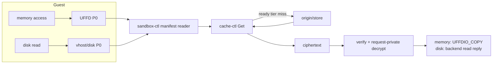
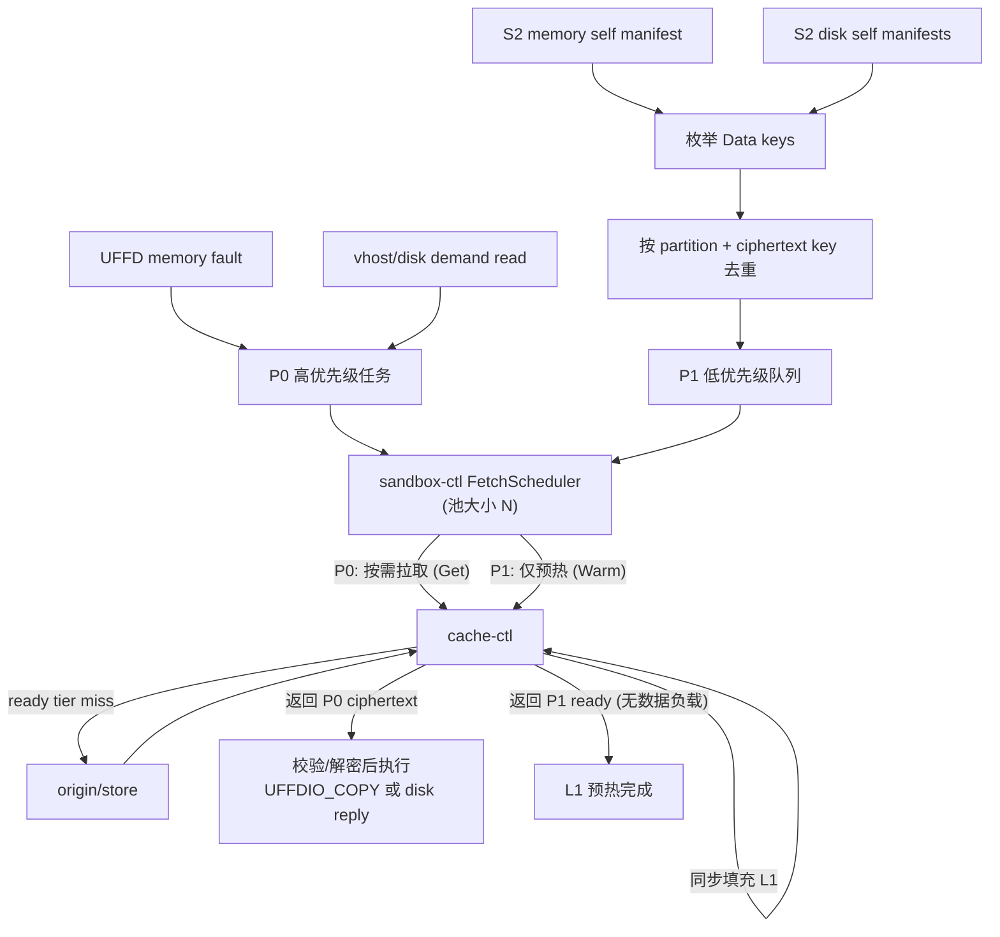

# 提案：Manifest 热点 Chunk 预热与 P0/P1 共享调度

> 状态：提案，待按 upstream 基线实现
>
> 范围：单个 VM 的 remote `manifest://` S2 restore；同时覆盖 Guest memory 与虚拟 disk 的 manifest 数据路径
>
> 代码基线：实施时以两个仓库的 upstream `origin/main` HEAD 为准；本文不依赖、也不要求沿用本地已有的 warming/prefill 实现。

## 摘要

在 `manifest://` 远程快照恢复（remote snapshot restore）场景中，核心性能瓶颈并非 UFFD handler 缺乏并发能力，而是 Guest OS 内部的执行依赖导致了 I/O 请求的串行化。

具体来说，许多后续的数据块（chunk）请求，必须等待前一个缺页中断（fault）处理完毕后才会产生。处理一次 UFFD fault 是一条漫长的同步链路：系统需要先定位 manifest chunk，接着从 cache 或远端 origin 拉取密文，再经过校验和解密，最后调用 `UFFDIO_COPY` 将明文页面注入。只有完成这整个流程，被阻塞的 vCPU 才能继续执行。

同样的现象也发生在虚拟磁盘（disk）侧：受限于文件系统结构和应用程序逻辑，新的 Guest I/O 请求往往要在前序读写操作完成之后才会暴露。

本提案引入一种预热机制，将第二次快照（**S2**）的 memory/disk self manifests 作为热点候选。通常，S2 会在执行过一段代表性业务请求后创建。其 self layer 中的 Data chunks，代表了快照生成那一刻仍保留在顶层的数据。

在恢复流程中，当 `sandbox-ctl` 取得并解析 S2 的 memory/disk manifest 后，会立刻枚举这些数据块。经过按密文内容哈希（ciphertext content key）去重后，系统会以后台低优先级（P1）的方式，将它们预热到 `cache-ctl` 的 L1 缓存中。

为了避免预热任务干扰正常业务，P1 不会独占后台线程池。它与线上需求（P0）共用一个 `FetchScheduler`，其并发上限为当前 VM 的 cache client 连接池大小：

- **P0（线上需求）**：指任何已导致 Guest 阻塞的必需读取操作，包括 UFFD memory fault 和 vhost/disk 按需读取。
- **P1（后台预热）**：指根据 S2 self manifests 触发的热点 chunk 预热请求（cache warming）。
- 调度器始终优先从 P0 队列中取任务，只有当 P0 队列为空时，P1 才能使用空闲的并发槽位（slot）。
- 对 `cache-ctl` 的预热调用（warm-only RPC）非常轻量。它仅负责从远端拉取密文并确保其存入 L1 缓存，既不把数据复制回 `sandbox-ctl`，也不进行解密或写入 Guest 内存/磁盘。

通过这套机制，我们可以把热点数据拉取的时间点大幅提前——从原来的“Guest 触发缺页后串行等待”，前置到“解析 manifest 后的主机侧并行拉取”窗口中。这既隐藏了网络 I/O 延迟，又维持了原有 P0 路径的正确性及按需恢复的语义。

## 1. 背景与问题定义

### 1.1 当前按需拉取路径的瓶颈

在 remote `manifest://` 恢复中，内存和磁盘都通过 manifest 定义的 chunk 获取数据。二者最终消费者不同，但 ciphertext 获取、校验与解密部分遵循同一条数据路径：



对于内存（memory），每当发生缺页中断（UFFD missing fault）时就会触发一个 P0 级别的高优先级请求。在相应的物理页被安装前，发生缺页的 vCPU 会一直处于阻塞状态。
对于磁盘（disk），当 vhost-blk（或同等块设备后端）收到 Guest 侧的 I/O 请求时，同样会触发 P0 读取。Guest 层的 I/O 线程必须等待底层数据准备完毕才能返回。

这两种情况都会将一连串耗时的操作（包括 L1 cache miss、远端网络 RTT、数据校验、哈希解密等）直接暴露在应用首请求的关键路径上。由于 Guest 端的线程受限于业务逻辑和 I/O 依赖（请求只能“分批”且“浅队列”地呈现），即使在后端增加多个并发 worker，也无法提前预知并拉取数据，导致实际表现往往退化为“按块串行拉取”。

### 1.2 S2 快照与设计机会

若 S2 是在 S1 恢复后、执行了一段代表性业务窗口再创建的快照，其演进过程大致如下：

```text
运行中的 VM
  -> 生成基线快照 Snapshot S1
  -> 恢复 S1，并执行代表性业务请求或训练窗口
  -> 生成带有业务状态的新快照 Snapshot S2 (作为新的 checkpoint 顶层)
  -> 后续的业务恢复将以 Restore S2 为目标（即本提案优化的核心路径）
```

在这种模式下，**S2 的 self manifest**（即 S2 自身保存的数据清单，不含由 `from_refs` 继承的基线数据）实际上记录了一组非常接近未来初始运行所需的数据快照。

我们提取其中非零 Data entries 所引用的 ciphertext keys，并按 key 去重后，即可将其作为优质的**热点候选**。预热这些数据无需事先获知精确的页面或扇区访问顺序；只要在真正的按需读取（P0）到来前，提前将这些密文数据填入 L1 缓存，就能成功将最慢的远端拉取（origin fetch）环节从关键路径中剔除。

需要强调的是，S2 self layer 只能算作一种“近似”热点信号：它缺乏访问时间、访问频率及顺序等精确信息，可能掺杂了后台任务的数据，也会漏掉业务分支带来的新数据。
因此，本方案并非“完整工作集恢复”，也绝不会提前将数据静默注入到 Guest 中。预热（P1）操作必须保证绝对安全，不影响数据正确性。对于未能预热、预测失败、属于基线层或首次出现的内容，一律交由原有的按需拉取路径（P0）来托底处理。

## 2. 目标与非目标

### 2.1 设计目标

- **尽早启动**：在 `sandbox-ctl` 获取 S2 manifests 后，立即启动热点 chunk 的预热操作。
- **并发控制**：在单个 VM 维度，使用一个共享的并发上限来统筹调度内存和磁盘的所有 P0 与 P1 请求。
- **队列准入优先**：确保等待中的 P0 需求在任何新释放的并发槽位（slot）上优先于 P1；不宣称可抢占已发出的 P1 RPC。
- **语义明确**：要求 cache-ctl 侧的 warm-only 操作只要返回成功，就严格代表数据在 L1 缓存中已就绪可读。
- **可观测性**：提供丰富的监控指标，用于评估 P1 预热是否真正降低了 P0 的远端拉取次数及首请求延迟，抑或是否引入了不必要的资源竞争。

### 2.2 非目标（本提案不包含的内容）

- **不触及前端注入**：不提前执行 `UFFDIO_COPY`，不构建明文级别的 page cache。
- **不进行全量恢复**：不会将完整 memory/disk 内容读入 Guest，也不主动预热完整的基线父层数据；P1 仅遍历 S2 self manifests 的 metadata 并按预算执行 warming。
- **不越权调度**：不要求底层 `cache-ctl` 介入 VM 级别的业务优先级策略。
- **不处理全局资源隔离**：不涉及跨 VM 的公平性调度、租户配额限制或节点级带宽治理。
- **不引入复杂预测**：不实现基于 GPA/扇区空间局部性的猜测性预读，不采集访问 trace，不进行访问频率学习或精确的顺序重排。
- **不消除本地开销**：不承诺降低数据校验、解密、内存拷贝、内核 ioctl 调用及磁盘后端处理的本地耗时。

### 2.3 核心不变量

为了保证系统稳定性与正确性，本提案在任何情况下都必须遵守以下底线规则：

1. **无阻塞恢复**：VM 恢复执行的流程绝不等待任何 P1 预热任务完成，也不关心 P1 队列是否清空。
2. **状态只读**：P1 预热绝不向 Guest 内存或磁盘后端写入明文数据；它的唯一作用是让密文数据在 L1 缓存中就绪。
3. **P0 完整性**：每一个按需请求（P0）在触发时，仍会严格执行完整的完整性校验、私有解密，并完成原有的内存/磁盘最终交付动作。
4. **底层防重**：针对同一个 key，并发的 P0/P1 请求在底层 cache/origin 侧只能触发一次真实的拉取动作，后到者必须 join 到前一个 in-flight 任务中。
5. **降级安全**：无论是 P1 预热出错、被取消、遗漏了热点，还是 S2 的预测数据存在偏差，P0 都必须能无缝退化到直接向 cache/origin 请求，确保业务恢复的绝对正确。

## 3. 总体架构

本提案对 Guest memory 和 root/data disk 的预热，采用了完全对等的候选提取与调度策略：

| 数据类型       | S2 热点来源 (P1)                              | P0 触发者                      | P0 的最终交付动作              |
| -------------- | --------------------------------------------- | ------------------------------ | ------------------------------ |
| Guest memory   | S2 memory self manifest 的 Data chunks        | UFFD missing fault             | 执行 `UFFDIO_COPY` 或零页处理  |
| root/data disk | S2 对应 disk self/top manifest 的 Data chunks | vhost/disk backend demand read | disk backend 响应 Guest 的读取 |

核心架构流程如下：



在上述架构中，各组件的职责边界非常清晰：

- **sandbox-ctl**：作为单一 VM 生命周期的管理者，它了解 memory/disk 的业务逻辑，知道何为 P0 需求、何为 P1 预热。因此，它负责统筹优先级队列、总并发控制、任务取消机制，并收集该 VM 维度的监控指标。
- **cache-ctl**：作为一个纯粹的底层数据服务，它只负责根据 key 查找或获取 ciphertext 并填充 L1 缓存。它不理解也不关心什么是 VM、S2 快照，或者请求是来自于 memory 还是 disk。
- **cache/store 底层**：必须提供 content-key 级别的 singleflight（防击穿）机制，确保同一时刻无论是谁（P0 还是 P1）发起的相同 key cache miss，最终只会触发一次远端 origin 拉取。

## 4. 最早启动时机与生命周期

### 4.1 启动顺序

P1 预热任务不依赖 UFFD 守护进程的启动，更无需等待前端恢复流程完成；事实上，只要解析到 S2 的 manifests 并在内存中可以枚举，预热就应立即开始。

理想的启动时序如下：

```text
1. sandbox-ctl 获取 S2 snapshot 配置及 memory/disk manifest 引用。
2. 打开 S2 self manifests，解析出各自有效的数据范围。
3. 创建本 VM 专属的 FetchScheduler 调度器，并发上限 N 复用现有的 cache client pool 配置。
4. 立即启动 producer：扫描所有 self manifests 的内容，按 key 进行去重，并将结果投递为 P1 任务。
5. （在后台 P1 开始运行的同时）并行推进常规的恢复流程：打开 from_refs、构造 memory/disk 的多层 readers、准备 Cloud Hypervisor、UFFD 句柄及 vhost 状态。
6. 触发 VM 恢复执行。此时 P1 仍会在后台默默运行，但绝不构成恢复路径的阻塞屏障。
7. 若 restore 失败或 VM 退出生命周期：立刻停止投递新 P1 并取消等待中的 P1，清空 scheduler，最后安全关闭所有的 manifest stream。
```

> **注意**：第 4 步的动作必须放置在那些耗时的准备工作（如解析巨大的父层引用、挂载磁盘设备、VMM 内部状态重置等）**之前**，或至少与其**并行**。只有这样，才能抓住主机恢复阶段“P0 请求还未到来”的宝贵空闲窗口。否则，预热就会退化为与应用首请求完全重叠的后台资源竞争，失去抢跑的意义。

### 4.2 self manifest 范围与枚举

为了防止将完整的快照演进历史退化成庞大的全量 I/O 工作，**只有 S2 当前版本自身新增保存的 manifest data 可进入 P1 预热池**。对于记录在 `from_refs` 中的历史父层数据，一律不做主动预热，继续交由按需路径（P0）通过 layered manifest 层层解析访问。

在扫描范围上，每个数据对象的 producer 仅遍历其对应的 S2 self manifest：

```text
memory self manifest 扫描范围: [0, guest_memory_capacity)
disk self manifest   扫描范围: [0, captured_disk_logical_size)
```

对于其中的每一个 Data entry，提取出 `(partition, ciphertext key, ciphertext bytes)` 三元组，并在这一过程中自动跳过预留的空洞（hole）和显式全零块（explicit zero）。
为了防止不同存储命名空间下的同名数据造成哈希碰撞，全 VM dedupe map（去重表）的键必须同时包含 `partition` 标识。

> **接口要求**：manifest stream 需要提供等价于 `WalkDataChunks(start, end, fn)` 的遍历能力，自动跳过 hole 与 zero chunk，并返回逻辑边界和 content key。多个 manifest producer 可以并发扫描，但它们必须经由 scheduler 的线程安全 `SubmitP1` 入口提交；该入口在同一临界区完成 VM 级去重、记录 `kind`、入队与唤醒 worker。producer 数量不得突破 P1 的并发上限 `N`。

由于 P1 本身只是近似热点，无法获知精确的真实访问顺序，因此第一版方案**不将 manifest 存储的顺序等价于访问顺序**。
不过，在 P1 任务内部，可以引入一个稳定的子优先级策略。默认采用 `memory-first`，即优先清空 memory self manifest 产生的任务，再去处理 disk 任务（在同一 `kind` 内部则保持按 manifest 存储顺序 FIFO）。这是因为内存的 UFFD fault 发生时，对应的 vCPU 会被硬性挂起；而磁盘 I/O 往往还有 virtio 环形队列及 Guest I/O 调度器提供一定的并发缓冲。
需要强调，这仅仅是针对**后台预热**的排序策略，决不能干扰 memory P0 和 disk P0 之间完全对等的 FIFO 处理原则。在进行 POC 测试时，需提供 `fifo` 混合排序作为对照组，以实验数据佐证上述假设的合理性。

### 4.3 任务取消机制

若遇到中断或失败，系统将按照以下顺序安全中止：
1. 叫停所有 producer，停止向队列投递新的 P1。
2. 清空并丢弃队列中尚未开始执行的 P1。
3. 对于已经发送到底层的在途请求，依附其 Context 超时或完成来释放。
4. drain (抽干) 调度器内部的 worker 线程。
5. 安全关闭所有的 manifest stream。

在这个过程中，P0 任务拥有最高豁免权，绝不会受到 P1 取消流程的波及。即便在 VM 正常运行期间手动触发 P1 取消，已入队或在途的 P0 结果也保证不会丢失。

## 5. 共享并发与优先级调度

### 5.1 P0 与 P1 调度语义

为了避免概念混淆，这里对两个调度等级进行明确定义：

- **P0 demand (按需拉取)**：代表 Guest OS 正在焦急等待的必需性读取操作。不论是内存的 UFFD fault，还是虚拟磁盘的 demand read，统统视为 P0 级别，两者地位完全对等。
- **P1 prefetch (提前预热)**：代表基于 S2 热点推测出的后备预热任务。它可以被随意延后、中途取消，甚至允许失败。它唯一的底线就是：绝不能阻塞正常的恢复流程，更不能篡改 Guest 的内存或磁盘状态。

值得注意的是，P0 和 P1 代表的仅仅是“紧急程度（调度等级）”，并非不同的数据结构格式。两者在底层调用的都是完全相同的 immutable ciphertext 数据块，唯一的区别是目标手段：一个是“拿到数据去注入”，另一个是“让数据在缓存就绪”。

### 5.2 为什么不能为 P1 新建独立 pool

在直觉上，给 P1 建立一个独立的线程池似乎能实现隔离。但这其实是一种错觉：由于底层带宽和计算资源是固定的，如果原先的并发度是 `N`，建立独立线程池只会将总并发野蛮地扩大到 `N + M`。这样不仅无法隔离，反而会导致 P1 在 cache-ctl、远端 origin 节点、NFS、CPU 以及网络链路上与宝贵的 P0 发生更剧烈的争抢。
此外，独立线程池无法从语义上表达“只有当 UFFD/disk 完全空闲时，我才敢挪用剩余带宽进行预热”这一核心诉求。

因此，本提案明确要求：将该 VM 对 cache-ctl 的**总 in-flight 请求上限统一收口为 `N`**（默认复用现有的 cache pool 配置值）。无论请求是紧急的 memory P0、disk P0，还是闲置的 P1 预热，要想下发给底层，必须在同一个 scheduler 中申请到宝贵的 slot 令牌。

在此基础上，引入 `p1_max_slots` 配置（取值范围 `0..N`，默认 `N`）。它限制“同一时刻最多允许几个 P1 并发运行”，但不降低 P0 可使用的总 slot 数：
- 设为 `0`：一键关闭 P1 预热功能，但复用这套可靠的调度器。
- 设为 `N-1`：P1 最多占用 `N-1` 个 slot，为 P0 保留一个可立即取得的 slot。
- 设为 `N`：默认激进模式，在完全没有 P0 的准备期，榨干所有带宽最大化预热吞吐。
这样的参数设计，使得我们在进行 A/B/C 组对比测试时，仅需更改一行配置，而无需因为观测到竞争去推翻重写整个调度器代码。

### 5.3 队列出队规则

调度器的核心是一个并发度为 N 的 task 管道模型：

```go
type Priority uint8

const (
    P0 Priority = iota // 线上紧急请求 (UFFD memory 或 disk demand)
    P1                 // 后台推测预热 (S2 hotspot warm-only)
)

type FetchScheduler struct {
    slots chan struct{} // 容量严控为: cap(slots) == cache.pool == N
    p0Q   taskQueue
    p1Q   taskQueue
    byKey map[requestKey]*inflight
}
```

任何一个 worker 线程在获取到空闲 slot 后，必须严格遵守以下贪心出队规则：

```text
if p0Q 不为空:
    无条件取出一个 P0 执行
else if p1Q 不为空 且 当前运行的 p1 数量 < p1_max_slots:
    取出一个 P1 执行
else:
    挂起等待新的任务投递
```

这套规则保证：只要有 slot 被释放，等待中的 P0 一定先于 P1 获得该 slot。
- **P0 队列内部**：暂不引入复杂的 memory-vs-disk 权重，统一按请求到达的时间戳进行 FIFO 处理，力求公平稳健。
- **P1 队列内部**：在允许出队的前提下，默认先掏空 memory 的子队列，再去处理 disk 的子队列。若是配置为 `fifo` 混合策略，则不加区分，完全按照初始提交的顺序出队。

### 5.4 非抢占式边界与局限

必须要承认，在当前的分布式存储架构中，一个已经发往 cache-ctl 甚至远端 origin 的 P1 请求，是无法被“安全且低成本地”半路抢占或强制掐断的。
因此，如果某一时刻所有 `N` 个 slot 都在执行 P1，随后到达的 P0 仍需等待最先结束的一个 P1 归还 slot。

综上所述，本提案声称的“P0 第一优先级”，其精确定义是**“队列准入优先”**，这并不等同于“绝对零等待”或“任意强制中断远端 I/O”。

第一阶段采用非抢占模型：它在没有 P0 的窗口能够充分利用可用并发，且实现边界较小。只有当实测指标证明 P1 导致 P0 尾延迟放大时，才考虑更强的保护机制：

| 防御方案                | 对 P0 的保障机制              | 副作用与代价                   | 启用条件                   |
| ----------------------- | ----------------------------- | ------------------------------ | -------------------------- |
| 非抢占 P0-first（默认） | 下一个释放的 slot 优先给 P0 | 极端情况下 P0 等待一个在途 P1 | POC 第一阶段起点 |
| P0 预留 (`N-1`) | P1 最多占 N-1 个 slot | 空闲期少一个 P1 并发 | P0 尾延迟放大被证实 |
| P1 取消或分段 | 受协议取消粒度约束 | 实现复杂，可能浪费已拉取数据 | 预留 slot 仍不足 |

在没有可观测性数据证实需要之前，第一版不引入跨 RPC 优先级传递、origin priority 或内核态抢占。

### 5.5 同 Key 合并与优先级提升

无论是上层的调度器，还是下层的 cache fetcher，都必须具备基于 `(partition, key)` 的归一化聚合能力，以彻底消除针对同一块数据的重复拉取：

1. **P1 排队中，P0 到达**：P1 尚未取得 slot 时，scheduler 将该 entry 从 P1 队列提升至 P0 队列；只执行一次底层请求。
2. **P1 已发出 warm-only RPC，P0 到达**：P0 仍须发出自己的 `Get`，因为 warm-only 不返回 ciphertext。cache-ctl 的服务端 content-key singleflight 将该 `Get` 与在途 `Warm` 合并；P0 在 `data-ready` 时获得 ciphertext，P1 在 `L1-ready` 时完成。两者不重复 origin GET。
3. **P0 已在执行，P1 到达**：P1 作为同 key joiner，等待该 entry 的 `L1-ready`，不能再发起独立 origin 请求。
4. **数据已在 ready tier**：P0 直接取得 ciphertext；P1 立即完成，二者均不触发 origin fetch。

> **区分两个就绪事件**：P0 需要 `data-ready`，即取得 ciphertext 后在 sandbox-ctl 完成校验、解密与最终交付；P1 只等待 `L1-ready`，即 cache-ctl 已将 ciphertext 同步填入目标 ready tier。P0/P1 的合并发生在 cache-ctl 服务端，而不是让 sandbox-ctl 从 warm-only 响应中取得 ciphertext。

## 6. cache-ctl 的 warm-only 接口

### 6.1 预热专用的轻量级接口与响应

所谓的 `Warm(partition, key)`，其实就是一个“不要求返回数据 Blob”的特殊 cache 访问接口：

> **接口要求**：cache-ctl 必须在 content-key singleflight 内区分 `data-ready` 和 `L1-ready`。`Get` 在 `data-ready` 返回 ciphertext；`Warm` 在目标 ready tier 已完成同步填充后返回成功，且不返回 blob。该语义不能依赖异步 backfill 的最终完成。

它的处理逻辑与返回值映射如下表：

| 触发情况                    | cache-ctl 的响应 | 回传的数据负载 (payload) |
| --------------------------- | ---------------- | ------------------------ |
| 发现 key 已存在于 L1        | `hit`            | 无 |
| 远端拉取命中，且刚同步存入 L1| `hit`            | 无 |
| 远端 origin 明确告知数据不存在 | `miss` | 无 |
| 网络中断、origin 读取失败或存 L1 失败 | `error` | 无 |

P1 返回 success 的语义是：**响应返回时，该 key 已在目标 ready tier 可读**。这不承诺该 key 在未来持续驻留；后续 eviction 仍可能使 P0 miss。cache-ctl 不得在 origin 数据到达、但异步 backfill 尚未完成时提前回报 success。

### 6.2 L1 缓存容量与驱逐 (Eviction) 博弈

P1 的价值不仅取决于 warm 成功，还取决于数据在 P0 到来时仍驻留在 L1。若 S2 热点集合远大于 L1 容量，早期 P1 数据可能被后续 P1 或 P0 fill 驱逐，造成预热带宽已消耗而 P0 仍需 origin fetch 的抖动。

第一阶段 POC 不引入复杂的 cache partition 或 pinning 策略，但测试报告必须记录以下数据：
- 明确记录当前的 L1 物理容量上限、启动时的基线占用情况、本次 S2 候选去重后的总字节规模，以及采用的淘汰策略。
- cache-ctl 为成功 warm 的 key 提供可查询 lifecycle：`ready`、`evicted` 或 `unknown`。
- P0 查询该 key 遇到 miss 时，cache-ctl 将其标记为 `previously_warmed_not_resident`，而不是与从未 warm 的普通 miss 混合。

只有 cache-ctl 提供 eviction 证据，才能统计 `p1_evicted_before_p0`。sandbox-ctl 仅能基于“warm 曾成功、后续 P0 miss”记录 `p1_previously_warmed_not_resident_on_p0`；它不能区分 eviction、cache 重启或其他失效原因。

### 6.3 为什么 P1 要坚持“零数据拷贝”

warm-only 不向 sandbox-ctl 回传数据，避免以下无效成本：
- socket/network copy；
- sandboxer 侧 Blob buffer、引用计数与生命周期管理；
- P1 执行属于 P0 的 ciphertext 校验、解密或 `UFFDIO_COPY`；
- 后台预热改变 Guest 可见的 memory/disk 状态。

后续 P0 从 ready tier 获取 ciphertext，并根据真实的 memory/disk 请求完成校验、解密与交付。

## 7. 可观测性与 POC 验收指标

### 7.1 必须暴露的核心指标

监控数据必须严格按照来源类型（`kind=memory|disk`）以及请求等级（`priority=P0|P1`）进行正交分类。如果混为一谈，磁盘那极高的命中率很容易就把内存 UFFD 那凄惨的抖动给掩盖过去。

```text
# 热点池规模评估
s2_hot_keys_total{kind=memory|disk}

# P1 生命周期全链路追踪
p1_enqueued / p1_started / p1_completed / p1_errors / p1_cancelled
p1_ready_before_resume / p1_ready_before_first_p0
p1_ready_ciphertext_bytes{kind}

# 预热命中价值评估（核心）
p1_hit_by_p0{kind}                    # warm 成功且后续 P0 从 L1 命中的 distinct key 数
p1_wasted_at_vm_end{kind}             # warm 成功但 VM 结束前未被任何 P0 请求的 distinct key 数
p1_previously_warmed_not_resident_on_p0{kind} # 曾经暖过，但用时不在
p1_evicted_before_p0{kind}            # 仅在 cache-ctl 提供 eviction 证据时输出

# P0 业务健康度
p0_requests{kind=memory|disk}
p0_l1_hits{kind}
p0_origin_fetches{kind}
p0_joined_p1_same_key{kind}           # P0 与在途 P1 的同 key 合并次数
p0_waiting_behind_p1{kind}            # P0 因在途 P1 无 slot 可用而等待的次数
p0_wait_behind_p1_ns{kind}            # 该等待造成的时延

# 调度器水位状态
scheduler_slots                       # 并发池总容量 N
scheduler_p1_max_slots                # 当前配置的 P1 软限制
scheduler_inflight{priority=P0|P1}    # 各优先级正在路上的车辆数
scheduler_queue_depth{priority=P0|P1} # 积压在候车大厅的任务数
scheduler_p0_queue_delay_ns{kind}     # P0 等待 scheduler slot 的时延
```

在解读这些指标时，对 `p1_hit_by_p0` 的统计要求极其苛刻：它必须限定在同一次 VM 生命周期内，P0 的 L1 hit 必须有板有眼地追溯到这一次完成的 P1 操作。绝对不能把上一代 VM 遗留在机器上的缓存残渣算创业绩。
`p1_wasted_at_vm_end` 表示热点预测准确度的下界；它不包含“被 P0 请求前已被驱逐”的 key，后者由 eviction/not-resident 指标单列。

P0 延迟需拆分为：scheduler queue、cache/Get、hash verify/decrypt、页安装或块设备响应、端到端 service。cache-ctl 应单独报告 warm-only 成功率和延迟，不与 P0 服务端延迟指标混合。

### 7.2 科学的对照组设计

为了让数据具有说服力，实验必须控制单一变量：必须固定使用完全一样的 S2 快照包、投喂一模一样的业务压力脚本、保持一样的初始 L1 缓存环境和网络并发上限 `N`。
随后，系统按照打乱的随机顺序在不同配置组别间切换比对：

| 实验组编号 | 预热功能配置               | 调度器核心策略           | 设计目的与观测意图            |
| ---------- | -------------------------- | ------------------------ | ----------------------------- |
| 组 A       | 关闭（`p1_max_slots=0`）   | 专心致志只服务 P0        | 建立 Lazy Restore 的原始基线  |
| 组 B       | 开启（`p1_max_slots=N`）   | 共享 N slots，P0-first | 评估实际收益与竞争 |
| 组 C       | 开启（`p1_max_slots=N-1`） | 为 P0 预留一个 slot | 评估 reservation 的代价与收益 |
| 组 D (选做)| 开启，但 App 进程保持冻结 | P1 至完成或预算后 thaw | 测量无 P0 干扰的预热上界 |

组 D 仅用于测量预热上界。它改变用户进程实际可运行的时刻，因此不得与组 B 的端到端首请求延迟直接比较。

### 7.3 POC 阶段的通关条件

1. S2 manifests 可枚举后 P1 立即启动，且不阻塞 VM 恢复流程。
2. 相同 key 的 P0/P1 任意并发排列只产生一次 origin GET。
3. 与组 A 相比，组 B 降低 memory P0 的 origin fetch 数，并改善首请求或首次 I/O 的 p50/p99。
4. memory P1 不应造成 disk P0、disk P1 不应造成 memory P0 的不可解释尾延迟放大。
5. `p1_hit_by_p0`、`p1_wasted_at_vm_end` 与 eviction/not-resident 证据足以评估 S2 self manifest 的热点质量。
6. 若 `p0_waiting_behind_p1` 和 P0 长尾放大，组 C 能量化 P0 reservation 的成本与收益，为后续调度决策提供依据。

## 8. 实施演进路线

### 8.1 阶段一：最小可行性验证 (POC)

1. 为内存与各个磁盘的 S2 self manifest 提供 Data-key 迭代遍历能力（例如 `WalkDataChunks`）；并在 sandbox-ctl 层完成基于 `(partition, key)` 的全局去重。
2. 在 sandbox-ctl 中建立每 VM 专属的 `FetchScheduler(N)`，上限 `N` 复用当前 cache pool 配置。
3. 将所有 UFFD memory read 和 disk block read 作为 P0 任务经 scheduler 调度。
4. 热点枚举器在后台提交 P1 warm-only 任务。
5. 在 cache-ctl 提供 `data-ready`/`L1-ready` 的 singleflight，以及无 payload 的 warm-only RPC。
6. 提供 `p1_max_slots` 与 `memory-first | fifo` 配置，并采集第七章指标，执行 A/B/C 对照实验。

### 8.2 阶段二：由真实数据反推演进方向

仅当阶段一证明 P1 占满 slots 并放大 P0 尾延迟时，才引入 P0 reservation。若 reservation 仍无法满足目标，再评估 chunk 分段、P1 cancellation 或 origin priority。第一阶段不引入独立后台线程池或跨组件优先级协议。

## 9. 验收测试

- **多 producer 并发**：memory/root/data-disk producers 并发提交时，去重、队列与指标保持一致；同 key 只入队一次。
- **候选过滤与排序**：hole、zero 与父层引用不得产生 P1；`memory-first` 或 `fifo` 排序符合配置。
- **P0 队列优先**：P1 排队时 P0 到达，P0 在新释放 slot 上先于 P1 执行。
- **并发上限**：`p1_max_slots=0/N-1/N` 时，P1 in-flight 不超过对应限制，P0 仍可使用总 slot 上限。
- **排队任务提升**：P1 排队期间同 key P0 到达时，entry 提升为 P0，底层请求只执行一次。
- **在途 RPC 合并**：P1 已发 Warm 时同 key P0 发 Get，服务端合并为一次 origin GET，P0 获得 ciphertext。
- **跨 manifest 去重**：P0/P1 来源不同 manifest 但 ciphertext key 相同时，仍合并为一次底层请求。
- **Warm 就绪语义**：Warm 成功时目标 ready tier 已可读且响应无 payload；后续 eviction 时 P0 miss 带有 not-resident/eviction 归因。
- **取消**：取消停止新的 P1，已运行 P0 不受影响；P1 drain 后再关闭 streams。
- **恢复并行性**：VM 恢复不等待 P1；frozen-app 模式仅作为显式实验配置。

## 10. 风险与预期收益

预期收益来自将热点 chunk 的 origin fetch 与 L1 fill 前移到 restore 准备窗口，主要改善首请求的 P0 长尾。它不消除 missing fault，也不消除 L1 hit 后的校验、解密与最终 memory/disk 交付成本。

最大风险是 P1 在 P0 到达前占满共享 slots。该风险通过 P0-first 队列、同 key 合并和可观测指标显式管理；若实测显示 P0 受损，再使用 reservation 或 cancellation。该分阶段方式先验证 S2 热点收益，再为已证实的问题增加复杂度。
