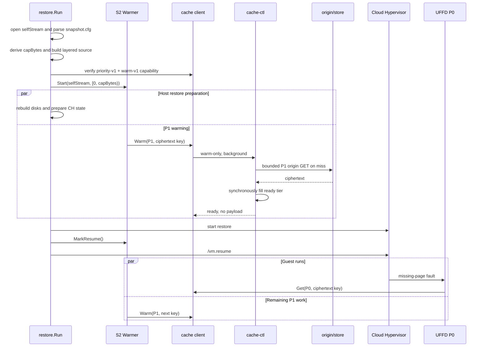

# 阶段二详细设计：异步 S2 Ciphertext Cache Warming 与 P0/P1 调度

> 状态：设计提案，尚未实现
>
> 范围：单个 VM 的一次 remote `manifest://` S2 restore
>
> 实施前置：阶段一必须先完成 ciphertext 不可变性和 content-key singleflight

本文是 [VM Snapshot Restore 预取技术调研报告](./vm-snapshot-restore-prefetch.md) 的阶段二落地设计。本文只研究一个 VM 内部的两类并发工作：Guest demand fault（P0）与该 VM 的 S2 self-layer warming（P1）。跨 VM 公平、租户配额、burst restore 和节点级全局带宽治理均不在本阶段范围内。

本方案固定采用**异步 ciphertext cache warming**，不采用恢复前全量 `UFFDIO_COPY`。这里的“异步”包含两层不同语义：

- 对 restore/Guest 而言，整个 warmer 是异步后台任务；启动后立即返回，不阻塞 CH 启动或 `/vm.resume`；
- 对单个 chunk 而言，warm-only RPC 必须等待 cache tier 完成 ready fill 后才返回成功，不能把 cache-ctl 内部尚未完成的异步回填记为 warmed。

因此，异步的是“完整 warming 任务相对 VM 生命周期的执行”，不是“cache-ctl 收到 origin 数据后不等回填就提前报告成功”。

## 0. 术语说明

`S1/S2` 与 `P0/P1` 是两套相互独立的编号：

- `S` 表示 snapshot version，即快照生成的先后顺序；
- `P` 表示 I/O priority，即恢复运行期间请求的调度优先级；数字越小，优先级越高。

### 0.1 S1 与 S2：两个先后生成的快照

```text
VM 初始运行
  -> 生成 Snapshot S1
  -> Restore S1
  -> Guest 完成 restore handshake 并执行代表性业务请求
  -> 生成 Snapshot S2
  -> 后续 Restore S2
```

- **S1**：第一次生成的基线快照。它保存训练前的 VM 状态。
- **S2**：Restore S1 并执行一次代表性训练窗口后生成的第二个快照。它是一个时间上更晚的 checkpoint，不只是 S1 的“热点索引”。
- **S2 self layer**：S2 相对父快照新保存的 sparse 顶层。当前 snapshot 机制只写入快照时仍 resident 的 Guest RAM extents，因此该层可以作为下一次 restore loading set 的候选集合。
- **S2 `from_refs`**：S2 指向的 S1 及更老父层。S2 self 中是 Hole 的地址，由正常 demand path 继续从这些父层查找。

S2 self layer 只能近似热点：它表示训练后仍 resident 的页面，不包含访问时间、频率和精确顺序，也可能混入 Guest 后台活动。本文恢复的是 S2 本身，因此 self layer 中的页面内容与 checkpoint 一致；第一版不使用 S2 去提示恢复 S1。

### 0.2 P0 与 P1：同一次 Restore 中的两类 I/O

- **P0 demand**：Guest 已经访问某个缺失页面，由 UFFD 触发的必需读取。Guest vCPU 正在等待它完成，属于 correctness path，优先级最高。
- **P1 warming**：根据 S2 self layer 提前发起的 ciphertext cache warming。它只是性能优化，可以延后、失败或取消，不能阻塞 P0，也不能改变 Guest RAM 内容。

同一个 chunk 可能先由 P1 warming 发起，随后又被 Guest 以 P0 demand 请求。此时 P0 应加入正在进行的同 key 请求；若请求尚未发往 origin，则将其提升为 P0。P0 不应重新发起一次 origin GET，也不应等待其他无关 P1。

本文不实现 P2。调研报告中的 P2 指低置信度的 fault-around 或空闲期后台工作，不属于本阶段。

## 1. 目标与边界

### 1.1 目标

Restore S2 时，利用 S2 self layer 已经记录的 resident Data 集合，在 Guest 首次访问前后并行地将对应 ciphertext chunks 拉入 `cache-ctl` 的 ready tier，使后续 P0 fault 尽量从 cache 命中，而不是同步等待 origin GET。

最终数据路径固定为：

```text
restore goroutine
  -> StartWarmer()
  -> 继续准备 CH
  -> /vm.resume
  -> 等待 VM 生命周期结束

warmer goroutines
  -> 枚举 S2 self Data chunks
  -> P1 warm-only RPC
  -> cache-ctl fetch ciphertext + ready fill
  -> 不返回 ciphertext payload
  -> 不执行 decrypt/UFFDIO_COPY
```

本阶段必须同时满足：

- warming 在 Guest CPU resume 前启动，但不成为 `vm.resume` 的等待栅栏；
- P1 与 Guest、UFFD P0 并行，Guest correctness 仍完全由现有 layered UFFD path 保证；
- P0 与同 key P1 合并；P0 不因无关 P1 发生连接池或 origin admission 的队首阻塞；
- P1 成功的定义是目标 cache tier 已 ready，而不是“origin 数据已经返回”；
- 第一版枚举并尝试 warming 全部 S2 self Data chunks，不设置 bytes/chunks 截断预算；
- P1 的并发、队列和生命周期仍然有界、可取消、可观测。

### 1.2 非目标

本阶段不实现：

- 跨 VM singleflight、公平调度、租户隔离或节点级 P1 总预算；
- 恢复 S1 时把 S2 membership 当作提示；第一版只恢复并 warming S2 本身；
- 向 Guest RAM 预先安装页面，或在 resume 前等待 working set 完成；
- P2 fault-around、时间分组、访问频率学习或在线预测；
- plaintext/verified cache、`UFFDIO_CONTINUE`、PMEM/CXL backing；
- 本地 `file://` snapshot warming；当前本地 snapshot 会 flatten 父层，无法保留独立 S2 self layer。

## 2. 当前代码基线与必须修正的问题

### 2.1 Restore 已具备的分层输入

`sandboxer/pkg/restore/restore.go` 当前同时持有：

- `selfStream`：当前 S2 snapshot bundle；
- `parsedSnap.FromRefs`：S1 及更老父层；
- `fetch.NewLayered([self] ++ from_refs)`：UFFD demand 的正确性数据源；
- `capBytes`：Guest RAM 在 bundle 中的有效区间 `[0, capBytes)`。

因此 warming 必须扫描 `selfStream[0:capBytes)`，不能扫描 layered stream。S2 hole 仍由 P0 demand 从 S1 或更老父层解析，P1 不主动读取父层。

### 2.2 普通 `cache.Get` 不适合作为最终 Warm API

当前 `manifestStream.readChunkInto` 的路径为：

```text
cache.Get -> SHA-256 -> DecryptInPlace -> copy
```

直接让 P1 调用普通 `cache.Get` 有两个问题：

1. `TieredCache.Get` 在 origin hit 后异步执行 `startFill`，随后立即返回。P1 收到 ciphertext 并 release，不代表 cache tier 已 ready；紧随其后的 P0 仍可能再次 miss。
2. ciphertext 会从 cache-ctl 传到 sandboxer 后被直接丢弃，产生无意义的网络传输和 buffer 生命周期成本。

因此阶段二新增 warm-only 操作：cache-ctl 在服务端完成 fetch 与同步 ready fill，成功响应不携带 payload。P1 不执行 hash、decrypt、page copy 或 UFFD ioctl。

### 2.3 旧 wire server 会忽略优先级语义

cache wire request 已有 `Flags` 字节，但旧 server 不解释它。仅增加 `P1` bit 虽不改变 39-byte frame 布局，却不能保证滚动升级时的调度语义：旧 cache-ctl 会把自动 warming 当作普通 P0 GET。

因此自动 warming 必须依赖 capability handshake。未确认整条 cache 远端链路支持 `priority-v1 + warm-v1` 时，restore 自动跳过 warming，不能降级成无优先级后台 GET。

## 3. 总体执行模型



关键时序决定如下：

- warmer 在 `selfStream`、`snapshot.cfg`、`capBytes` 和 layered memory source 就绪后启动；
- 启动点位于 `ServeAndWait` 之前，使 P1 可与磁盘重建、CH 启动和 Guest 运行重叠；
- `PostSpawn` 在调用 `/vm.resume` 前仅调用 `MarkResume()` 记录边界，不等待 warmer；
- Guest resume 后，未完成的 P1 继续运行；任何 P0 到达都会获得更高 admission 优先级；
- restore 任意失败或 VM 退出时执行 `cancel -> drain workers -> close selfStream`。

## 4. 启用条件与自动降级

warming 不增加显式 `enabled` 开关。以下条件全部满足时自动启动：

1. restore 输入是 remote `manifest://`；
2. `parsedSnap.FromRefs` 非空，证明当前 self 是一个增量顶层；
3. snapshot key 对应单一 manifest stream，而不是 `key1:key2` composite stream；
4. `capBytes > 0`；
5. self stream 支持 Data chunk 枚举；
6. cache client 已通过 handshake 确认 `priority-v1` 和 `warm-v1`；
7. 若 cache topology 包含 EC/upstream remote hop，所有相关 hop 均确认 priority 能力。

以下情况只记录 skip reason，restore 继续正常执行：

- `file://` snapshot；
- 没有 `from_refs` 的单层 snapshot；
- composite self stream；
- manifest 配置没有 cache endpoint、直接回退 store；
- 旧 cache-ctl、旧 EC peer 或旧 upstream 不支持 capability；
- self manifest 不可枚举或 cache topology 没有 writable ready tier。

warming 是纯性能优化。资格检查、扫描或任一 P1 请求失败都不能使 restore 失败。

## 5. S2 Self Chunk 枚举

### 5.1 新增可选 stream 能力

在 `accelerator/pkg/manifest/fetch` 增加只由单 manifest stream 实现的接口：

```go
type WarmChunkRef struct {
    Index      uint64
    Offset     uint64
    End        uint64
    CipherSize uint32
    Key        store.ContentKey
}

type WarmableChunkStream interface {
    Stream
    WalkDataChunks(start, end uint64, fn func(WarmChunkRef) error) error
    WarmChunk(ctx context.Context, ref WarmChunkRef) error
}
```

语义约束：

- `WalkDataChunks` 直接遍历已认证 manifest entries，不通过 `ReadAt` 重新解析；
- 只返回与 `[start, end)` 相交的非 `IsZero` Data entry；
- chunk 跨越 `capBytes` 边界时仍 warming 整个 ciphertext chunk；纯 ZIP trailer chunk 不返回；
- Hole 不在 entries 中，Zero entry 显式跳过；
- 结果按 logical offset 升序，第一版不伪造访问时间顺序；
- `WarmChunk` 只调用 cache warm-only API，不读取 key table、不校验 ciphertext、不解密。

P0 demand 仍通过现有 `ReadChunkAt` 执行 ciphertext SHA-256 与 decrypt。warming 不改变 integrity boundary。

### 5.2 流式调度与去重

warmer 使用：

- 1 个 producer；
- 4 个 P1 worker；
- 容量为 8 的有界 channel；
- 一个以 `store.ContentKey` 为 key 的 VM 内去重集合。

producer 按 offset 遍历 self entries，第一次出现的 ciphertext key 入队，重复 key 只增加 dedup 计数。不得先构建全量任务 slice。即使第一版 warming 全部 self Data chunks，内存占用和 goroutine 数也必须有界。

第一版不设置 bytes/chunks 上限。这里的“全量”仅指当前 S2 self memory 区间中的唯一 Data chunks，不包括父层、Hole、Zero 和纯 ZIP trailer。

## 6. Cache API 与 Wire 协议

### 6.1 Go 接口

保留现有 `cache.Getter`，保证已有调用点兼容；`Get` 永远表示 P0：

```go
type Priority uint8

const (
    P0Demand Priority = iota
    P1Warming
)

type PriorityGetter interface {
    GetWithPriority(
        ctx context.Context,
        p store.Partition,
        key store.ContentKey,
        priority Priority,
    ) (CacheResult, Blob, error)
}

type PriorityWarmer interface {
    WarmWithPriority(
        ctx context.Context,
        p store.Partition,
        key store.ContentKey,
        priority Priority,
    ) (CacheResult, error)
}
```

规则：

- `Getter.Get(...)` 等价于 `GetWithPriority(..., P0Demand)`；
- UFFD、ZIP metadata、普通 disk read 均保持 P0；
- 只有 S2 warmer 调用 `WarmWithPriority(..., P1Warming)`；
- local Rocks/Redis lookup 可以忽略 priority，但所有远端 dispatch 和 origin admission 必须传播 priority；
- EC topology 同步增加 `PriorityShardGetter`，P1 标记必须传到 peer shard GET；否则该 topology 不发布 capability。

### 6.2 Wire flags 与 capability

不改变 request/response frame 长度：

```text
Request.Flags
  bit 0: background/P1
  bit 1: warm-only

Response.Flags（复用当前 Reserved byte）
  bit 0: priority-v1 supported
  bit 1: warm-v1 supported
```

新 server 的 Ping 返回 capability bits；旧 server 返回 0。cache client 建连时探测并缓存 capability：

- 普通 P0 GET 不要求 capability，可连接新旧 server；
- P1 warming 只在两个 bits 均存在时可用；
- cache-ctl 只有在本地 tier、EC peers 和 upstream 共同满足语义时才向下游发布 capability；
- capability 丢失或重连到不兼容节点后，停止接收新的 P1，已运行请求由 context 收口。

warm-only response 只返回 HIT/MISS/ERROR，不携带 Blob。HIT 表示请求前已命中 ready tier，或本次从下层取得数据并至少成功填充一个本地 ready tier。

## 7. P0/P1 调度与 Same-key 合并

### 7.1 资源隔离

单 VM 第一版使用以下默认值：

| 资源 | P0 | P1 |
|---|---:|---:|
| sandboxer -> cache-ctl connection pool | 现有 4 | 独立 4 |
| warmer workers | 不适用 | 4 |
| warmer queue | 不适用 | 8 |
| origin background in-flight | 不受 P1 gate 限制 | 最大 4 |

P0/P1 使用独立 connection pool，避免一个连接上的同步 request/response 和 pool acquire 形成 HOL。P1 pool 不得作为 P0 fallback；P0 pool 也不承接 P1。

cache-ctl 的 priority origin adapter 在内部统一完成 admission，不再向现有 `tryTier` 暴露旧 `Semaphore`：

```text
P0: acquire total -> origin -> release total
P1: acquire p1 -> acquire total -> origin -> release total -> release p1
```

必须先取得 P1 gate，再等待 total，避免 P1 持有 total slot 等待 P1 gate。新 P1 在存在 P0 waiter 时不得 dispatch；已经发出的 P1 不强制中断。

`origin.max_inflight > 0` 时，`background_max_inflight` 必须小于 total，才可以声明有 P0 保留容量。默认 `background_max_inflight=4`；示例配置的 total 为 16，可为 P0 保留至少 12 个 admission slots。若 total 为 0（unlimited），只能声明“P1 最多 4 个”，不能声明固定 P0 保留槽位。

### 7.2 两阶段 singleflight 完成语义

阶段一的 content-key singleflight 在阶段二扩展为两个完成点：

```text
dataReady: origin/upstream 已返回不可变 ciphertext Blob
fillReady: 至少一个目标 cache tier 已完成同步 Fill
```

singleflight 位于 cache-ctl 的 `TieredCache`/origin fetch 边界，而不是 UFFD handler 或 sandboxer client。该位置能够合并来自 P0/P1 独立连接池的请求，并在服务端持有 origin Blob 与 ready-fill 状态。第一版只验证同一 VM 发出的 P0/P1；实现即使顺带合并其他 caller，也不在本阶段承诺跨 VM 公平或隔离。

同一 VM 发出的 P0/P1 使用 `(partition, content key)` 合并：

- P1 先到、P0 后到：P0 join 同一 entry；
- entry 尚未 dispatch origin：P0 将其从 P1 promote 为 P0；
- origin 已经发出：不复制第二次 GET，P0 join 现有 fetch；
- `dataReady` 后，P0 获得自己的 Blob clone 并立即继续 hash/decrypt，不等待 cache fill；
- P1 只有在 `fillReady` 后才记录 warming success；
- singleflight entry 至少保留到 `fillReady` 或所有 waiter 结束，避免 fill 窗口内的第二次 origin miss；
- P1 caller 被取消后，如果已有 P0 waiter，不能取消共享 fetch；最后一个 waiter 离开后才取消 leader；
- Blob 对每个 consumer 独立 Clone/Release，禁止对共享 cache Blob 原地 decrypt。

### 7.3 Ready fill

warm-only 在 source hit 后同步填充所有本次 miss 的上层 writable tiers，并等待 Fill 返回：

- 任一上层 tier 已命中：立即视为 ready；
- origin/upstream hit：并行 Fill 所有 miss 的上层 tiers，等待全部结束；
- 至少一个 tier Fill 成功：返回 HIT，同时记录 partial fill errors；
- 所有 Fill 失败：返回 ERROR，P1 记 failed；
- origin confirmed miss：返回 MISS；
- P0 demand 仍使用现有异步 fill-aside，不因 P1 的 ready 语义增加关键路径等待。

## 8. 生命周期、取消与错误处理

warmer 状态机：

```text
Ineligible -> Skipped
Eligible -> Running -> Completed
                    -> Canceled
                    -> CompletedWithErrors
```

行为要求：

- `Start` 非阻塞；producer 和 worker 都绑定 restore 子 context；
- `MarkResume` 只写一次原子时间戳；
- 单个 chunk MISS/ERROR 只更新计数并继续，不使 restore 失败；
- capability 变化、restore 失败、CH 退出或父 context 取消时，停止 producer，取消尚未 dispatch 的 P1，并等待 workers 退出；
- defer 注册顺序必须保证 warmer 的 `Close` 先于 `selfStream.Close`；
- 已开始的 P0 不因 warmer 关闭而取消；共享 entry 在 P0 waiter 完成前继续存活；
- `Close` 必须幂等，且不能无限等待不遵守 context 的 backend；继续沿用 cache/store 的现有 deadline 语义。

## 9. 配置与可观测性

### 9.1 配置

cache-ctl origin 配置新增：

```yaml
origin:
  max_inflight: 16
  background_max_inflight: 4
```

`background_max_inflight`：

- 省略或 0：默认 4；
- 必须非负；
- total 为正数时必须小于 `max_inflight`；不满足时 cache-ctl 不发布 priority/warm capability，并记录配置错误；
- 不新增 warming enable 开关。

sandboxer 第一版将 worker=4、queue=8 与 P1 pool=4 固定为内部默认值。先用指标验证后再决定是否暴露更多配置，避免在没有单 VM 基线前引入无依据的调参面。

### 9.2 Sandbox stats JSON

`ServeAndWait` 的 `statsReport` 新增可选 `warming` 段，现有字段不变：

```text
eligible, skip_reason
started_unix_ns, resume_unix_ns, completed_unix_ns
scanned_data_chunks, unique_chunks, duplicate_chunks
planned_ciphertext_bytes
ready_chunks, ready_ciphertext_bytes
ready_before_resume_chunks, ready_before_resume_ciphertext_bytes
cache_hits, origin_fills, misses, errors, canceled
inflight, max_inflight
```

`VMParams` 增加只读 `WarmingStats` snapshot provider。`restore.Run` 持有 warmer；`ServeAndWait` 在最终 stats JSON 写出时获取快照。该 provider 不控制生命周期。

### 9.3 Cache-ctl Info

在现有纯 Go stats 与 Info proto 中只追加字段，不修改已有 field number：

```text
p0_gets, p1_warms
p0_wait_ns, p1_wait_ns
p0_inflight, p1_inflight
p0_joined_p1, p1_promoted_to_p0
singleflight_leaders, singleflight_joiners
warm_ready, warm_miss, warm_errors
origin_p0_started, origin_p1_started
```

本阶段不在 wire request 中携带 VM identity。单 VM 实验通过运行前后 cache-ctl Info delta 与 sandbox stats JSON 对齐；这些指标不提供多 VM 归因保证。

## 10. 实施顺序

1. **Priority 基础接口与 capability**：新增 Priority/Warmer 接口、request/response flags、Ping capability；旧 client/server 的 P0 行为保持兼容。
2. **端到端 P1 传播**：实现 object、upstream、EC shard 的 priority 传播与独立 P1 pools；不完整的 topology 不发布 capability。
3. **Priority origin gate**：替换 origin adapter 的外置 semaphore 组合，落实 P1-first gate acquisition 和 P0 waiter 优先。
4. **Ready-aware singleflight**：实现 `dataReady/fillReady`、P0 join/promote、Blob clone 与 cancellation 语义。
5. **Warm-only server path**：同步 ready fill，响应不返回 payload；保持普通 P0 Get 的异步 fill-aside。
6. **Manifest 枚举与 warmer**：增加 `WarmableChunkStream`，在 restore 中加入自动 eligibility、流式 worker 和 lifecycle。
7. **统计与基准**：扩展 sandbox stats JSON、cache-ctl Info 和单 VM 对照实验。

前 5 步完成并验证前，不应自动启动 S2 warming；否则 P1 可能被当成 P0，或把“origin 已返回”误报成“cache 已 ready”。

## 11. 测试设计与验收标准

### 11.1 单元测试

**Manifest/warmer**

- 只枚举 `[0, capBytes)` 相交的 self Data entries；
- Hole、Zero、纯 ZIP chunk 被跳过；跨越 `capBytes` 的 Data chunk 只入队一次；
- 重复 ciphertext key 去重且顺序稳定；
- producer 使用有界 channel，取消后无 goroutine 泄漏；
- `WarmChunk` 不调用 decrypt、SHA、copy 或 UFFD。

**Wire/client/server**

- `Flags=0` 保持 P0 兼容；P1/warm-only flags 编解码不改变 frame 长度；
- 新 client 对旧 server capability=0，自动禁用 P1；
- P0 与 P1 使用不同连接池；
- warm-only HIT response 不含 payload；
- EC/upstream 每一跳均保留 P1；任一旧 hop 使顶层 capability 不可用。

**Singleflight/ready fill**

- P1 origin hit、fill 尚未完成时 P0 到达，实际 origin GET 仍为 1；
- P0 在 `dataReady` 后继续，不等待 `fillReady`；
- P1 只在 fill 成功后计为 ready；
- queued P1 被 P0 promote；已 dispatch P1 被 P0 join；
- P1 cancel 不取消仍有 P0 waiter 的 fetch；
- 每个 Blob clone 恰好 Release 一次，race detector 无共享 plaintext mutation。

**Priority gate**

- P1 的获取顺序严格为 `p1 -> total`；
- P1 数量不超过 4；
- P0 waiter 存在时不 dispatch 新 P1；
- context cancel、origin error 和 panic-safe cleanup 后 slot 全部归还；
- total 为 0 时只验证 P1 bound，不断言 P0 reserved slots。

### 11.2 Restore 生命周期测试

- 符合条件的 S2 在 `ServeAndWait` 前启动 warming；
- `MarkResume` 发生在 `/vm.resume` 前，resume 不等待 P1 完成；
- `file://`、无 `from_refs`、composite key、无 cache、capability 不足均自动 skip；
- ZIP parse、disk rebuild、CH start、resume、运行期退出等每个失败点都执行 `cancel -> drain -> stream close`；
- P1 failure 不改变 Guest 恢复内容和最终应用输出。

### 11.3 单 VM 端到端对照

固定同一 S2、同一输入和单 VM，至少比较：

1. 冷 cache、纯 demand P0；
2. 理想 warm cache，用作“移除 origin I/O”的收益上界；
3. S2 warming + P0/P1 调度。

验收必须同时满足：

- warming 未增加 `restore start -> vm.resume` 的同步等待；
- 同 key P0/P1 overlap 时 origin GET 数为 1；
- P0 不等待无关 P1 connection pool 或 P1 gate；
- `ready_before_resume` 与首请求 cache hit 提升具有可解释对应关系；
- 首请求窗口的 origin miss、UFFD fault stall total/p99 和应用首响应延迟优于纯 demand 基线；
- Guest 输出、snapshot identity、layer fallback 和 ciphertext integrity 校验与基线一致；
- `go test -race` 下无 Blob、singleflight、worker lifecycle 数据竞争或泄漏。

如果理想 warm cache 相比纯 demand 的收益已经很小，应停止扩展 warming，转而优化 hash/decrypt/copy/ioctl；如果 S2 warming 明显落后于理想 warm cache，则先分析 `ready_before_resume`、顺序和 P1 origin latency，不在本阶段引入 P2 或多 VM 调度。
