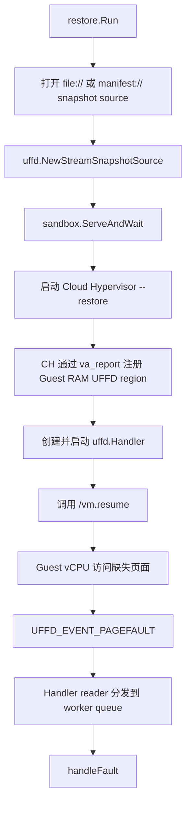
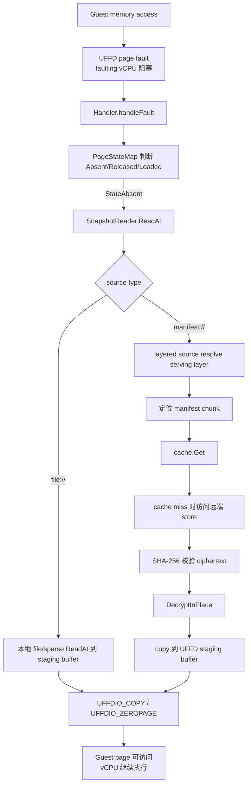
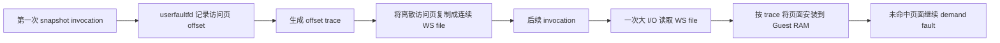
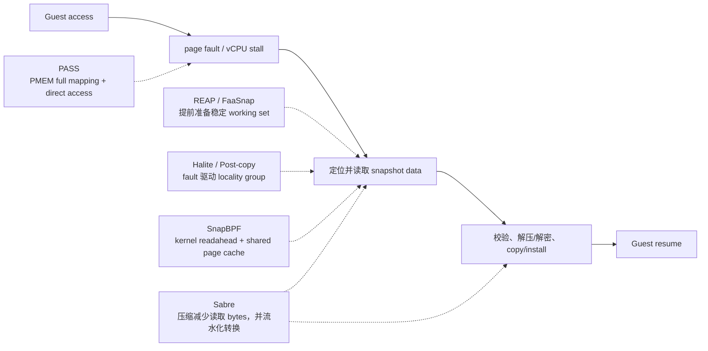
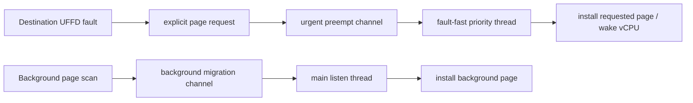
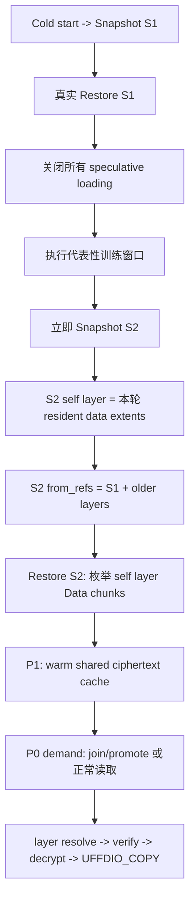

# VM Snapshot Restore 预取技术调研报告

## 1. 背景与当前问题

### 1.1 场景说明

当前项目使用 Cloud Hypervisor 承载 VM，并通过 external userfaultfd（UFFD）实现 Guest RAM snapshot 的延迟恢复。Restore 首先恢复 VMM、设备和内存映射元数据，但不立即将全部 Guest RAM 内容装入物理内存；Guest 恢复运行后，首次访问尚未 materialize 的页面会触发 UFFD page fault，再由 `sandbox-ctl` 从 snapshot source 读取数据并通过 `UFFDIO_COPY` 安装到 Guest RAM。

这种模型的优势是：

- `vm.resume` 前不需要读取完整 memory snapshot；
- 只为 Guest 实际访问的页面支付存储和内存成本；
- 未访问的冷页可以一直留在 snapshot store；
- 配合 balloon/reclaim，可以控制恢复后的实际内存占用。

其代价是，原本位于 Restore 阶段之外的 snapshot I/O 进入了 Guest 首次访问和首请求的关键路径。

### 1.2 当前核心代码流程

当前 memory restore 的控制路径如下。



关键数据路径如下。



主要代码位置：

- `pkg/restore/restore.go`：Restore 入口、snapshot source 组装和 VM 生命周期；
- `pkg/sandbox/serveandwait.go`：Cloud Hypervisor 启动、UFFD handler 建立和 `vm.resume`；
- `pkg/uffd/handler.go:handleFault`：page fault 热路径、状态判断、Source 读取和 UFFD ioctl；
- `pkg/uffd/source_stream.go:ReadAt`：snapshot stream 到 UFFD source 的适配；
- `accelerator/pkg/manifest/fetch/layered.go:ReadAt`：layered snapshot 的 serving layer 解析；
- `accelerator/pkg/manifest/fetch/fetch.go:readChunkInto`：chunk cache、校验、解密和 copy。
- `accelerator/pkg/cache/tiered.go:TieredCache.Get`：cache tier、origin 并发上限和异步 backfill；当前没有同 content key 的 miss singleflight。

### 1.3 为什么表现为“串行拉取块效率低”

当前实现并不是只有一个全局 worker：UFFD handler 有多个 worker，manifest `ReadAt` 也可以并发处理多个 data run，单次 fault 还可以在状态、region 和 source 边界允许时批量处理连续页。因此，问题不能简单归结为“代码完全单线程”。

关键约束在于，每个 demand fault 路径上都存在一条不可绕开的串行依赖链：

```text
Guest 触页
  -> faulting vCPU 停止
  -> 确定 snapshot offset
  -> 确定 serving layer/chunk
  -> cache/store 读取完成
  -> hash/decrypt/copy 完成
  -> UFFDIO_COPY 完成
  -> vCPU 才能继续
```

即使不同 fault 可以由多个 worker 并发，单个 Guest 执行线程的启动路径仍可能表现为“触一批页、等待一批块、继续执行、再触下一批页”。对于存在顺序依赖的启动路径，后续 fault 只有在前序 fault 恢复、Guest 执行推进后才会暴露，因此存储系统难以提前看到足够深的请求队列。

这会产生以下问题。

#### 关键路径上存在远端 I/O

`manifest://` miss 会在 faulting vCPU 阻塞期间执行 cache lookup、远端 fetch、hash validation、decrypt 和 copy。远端 RTT 或 cache 抖动会直接转化为首请求延迟。

#### Guest 页顺序与存储 chunk 布局不一致

Guest 按代码和数据依赖访问 GPA；manifest 则按 chunk、layer 和 content key 组织。相邻发生的 UFFD faults 可能落在不同 chunk，地址相邻页也可能由不同 snapshot layer 提供，导致读取离散。

#### UFFD 批量读取受多重边界限制

`handleFault` 可以尝试扩展连续 `StateAbsent` 页，但 batch 仍受到以下限制：

- UFFD region/PCI hole 边界；
- snapshot source 的 data/zero/hole 边界；
- manifest chunk 边界；
- layered source serving layer 变化；
- page state 已被其他 fault 或 CH materialize。

因此，Guest 地址上看似连续的页面，不一定能形成一次大的后端读取。

#### 同一 chunk 可能重复进入读取链路

多个离散 page range 可能属于同一 encrypted chunk。当前 tiered cache 已有 content-addressed 对象复用、origin 最大并发限制和异步 backfill 生命周期跟踪，但 `Get` miss 路径尚未看到按 content key 合并同一时刻并发读取的 singleflight：第一次 fill 完成前，多个 fault 或多个 VM 仍可能分别进入 origin GET。这里应区分三种能力：store 侧内容寻址去重解决“存几份”，ready cache 解决“已取回后是否复用”，singleflight 解决“首次并发 miss 是否只取一次”。

同 key 的重复 origin GET 是当前代码可以确认的工程缺口；hash/decrypt 是否也应跨调用复用，则取决于后续选择 ciphertext cache、verified cache 还是 plaintext page cache，不能与 origin singleflight 混为一谈。

#### Burst restore 可能形成 cache stampede

同一 snapshot 同时恢复多个 VM 时，它们通常访问相似 working set。如果每个 VM 独立 demand page，同一个 chunk 会在非常接近的时间被多次请求。即使最终都进入同一 cache，也可能在 fill 完成前产生重复 origin 请求。

#### 单纯增加 UFFD worker 收益有限

增加 worker 只提高已暴露 fault 的处理并发，不能解决以下问题：

- Guest 尚未执行到的未来 fault 不可见；
- 单个 faulting vCPU 仍等待完整链路；
- 小请求和后端布局不连续；
- 多 worker 可能加剧 cache/store 竞争；
- hash、decrypt 和内存 copy 仍消耗 CPU 和带宽。

### 1.4 问题本质

当前模型的核心矛盾是：

```text
Lazy restore 希望尽量晚、尽量少地读取 snapshot；
而低延迟首请求则希望在 Guest 使用前就准备好必需的数据。
```

合理的预取方案不应退回“恢复完整 snapshot”，而应预测并准备小而稳定的 loading set，同时满足：

- miss 继续走原有 demand paging，保证正确性；
- 不把过大的 working set 变成新的 `vm.resume` 栅栏；
- 调度粒度应理解 snapshot chunk 和后端布局，而不只是 4 KiB Guest page；
- demand fault 必须高于 speculative prefetch；
- 预取错误时只浪费受控资源，不能拖慢 Guest。

## 2. 论文实现调研

### 2.1 REAP：Record-and-Prefetch

论文：Dmitrii Ustiugov et al., *Benchmarking, Analysis, and Optimization of Serverless Function Snapshots*, ASPLOS 2021。

- 论文全文：<https://arxiv.org/pdf/2101.09355>
- DOI：<https://doi.org/10.1145/3445814.3446714>
- Artifact：<https://zenodo.org/records/4545584>

#### 关键观察

REAP 对 Firecracker snapshot-based FaaS 进行端到端测量，主要结论是：

- Snapshot 恢复后的函数处理时间比 warm 实例平均高 95%；
- 延迟主要来自 Guest RAM 按 4 KiB 页面延迟加载产生的大量 page faults；
- fault 页面空间局部性很差，平均连续 region 只有约 2 到 3 页；
- 研究结果显示，同一函数不同请求的 working set 高度稳定，workload 平均约有 97% 的页面相同；
- 从 snapshot 恢复时实际访问的 working set 通常显著小于完整 cold boot 后的内存 footprint。

#### 实现方法

REAP 分为 Record 和 Prefetch 两个阶段。



REAP 的关键优化并非只做并发读取，而是把 Guest 地址空间中离散的热点页重排成存储上连续的 working-set file。论文实验中，大块连续读取显著提高 SSD 带宽利用率，并减少 page fault 和系统调用开销。

#### 效果

- 平均消除约 97% page faults；
- 冷调用平均加速约 3.7 倍；
- 对 HDD 等随机访问更差的介质收益更明显；
- 第一次 Record invocation 有额外开销，论文平均约 28%。

#### 局限

- 完整 working set 在 Guest 运行前同步安装，working set 大时会形成启动栅栏；
- 输入大小、控制流或内存分配布局变化会降低命中率；
- 会读取本次请求实际不使用的历史页面；
- WS file 是额外存储对象，需要与 snapshot 生命周期、加密和 GC 一起管理；
- 论文结果基于其 Firecracker、local SSD 和 FunctionBench 环境，不能直接外推到当前 layered encrypted manifest 路径。

### 2.2 FaaSnap

论文：Lixiang Ao, George Porter, Geoffrey M. Voelker, *FaaSnap: FaaS Made Fast Using Snapshot-based VMs*, EuroSys 2022。

- 论文全文：<https://www.sysnet.ucsd.edu/~voelker/pubs/faasnap-eurosys22.pdf>
- DOI：<https://doi.org/10.1145/3492321.3524270>
- Artifact：<https://github.com/ucsdsysnet/faasnap>

#### 对 REAP 的反思

FaaSnap 指出，REAP 的完整 working-set 同步加载存在两个问题：

1. Guest 必须等待 working set 全部恢复；
2. 历史 working set 与新请求不一致时，未预测页仍会产生昂贵的 userspace fault，而已预测但未使用的页则会浪费 I/O。

#### 核心机制

**Concurrent paging**

Loader 与 Guest VM 并发运行，不等待全部 working set。Loader 先读到页面时，数据进入 host page cache，Guest 后续只产生较轻的 minor fault；Guest 先访问时则仍允许走 major fault。

**Working-set groups**

精确重放历史访问顺序会破坏磁盘局部性，纯地址排序又会延迟早期关键页。FaaSnap 将页面按历史访问时间划分为组：

```text
组间：保持历史时间顺序
组内：按 Guest 地址排序
```

这是一种 deadline/locality 折中。论文实验使用 1024 页一组，但该值与其 workload 和存储环境相关，不应直接照搬。

**Host-page recording**

FaaSnap 使用 `mincore` 周期性记录已进入 host page cache 的页面，而不只记录实际 major faults。这样可以把 OS read-ahead 带入的邻页纳入候选，提高输入变化时的覆盖率。

**Per-region mapping**

FaaSnap 将 Guest pages 分为：

| 页面类型 | 是否非零 | 历史是否访问 | 处理方式 |
|---|---:|---:|---|
| Loading set | 是 | 是 | compact loading-set file |
| Cold set | 是 | 否 | 原 memory file，按需读取 |
| Released set | 否 | 是 | anonymous zero memory |
| Unused set | 否 | 否 | anonymous zero memory |

**Region merge 与 compact loading-set file**

FaaSnap 允许合并小间隙 region，用少量额外读取减少 mmap 和 I/O 数。Loading regions 按 `(时间组, 地址)` 写入连续文件，loader 顺序扫描文件，Guest 地址仍通过映射恢复。

**共享 host page cache**

同一 snapshot 的多个 VM 可以复用 host page cache。Burst restore 时只需一个 loader 读取 loading set，其他实例可直接获得缓存收益。

#### 效果

- 相比 Firecracker 平均约 2 倍；
- 相比 REAP 平均约 1.4 倍，最高约 3.5 倍；
- 平均只比 snapshot 已完整驻留 host page cache 的理想基线慢 3.5%；
- 对 working set 变化和 burst restore 的适应性优于 REAP。

#### 局限

- Loader 跟不上 Guest 时，关键页仍会发生 major fault；
- 错误预测会增加 page cache 和 I/O 占用；
- 依赖普通文件、mmap 和 host page cache，不能机械复制到 external UFFD + manifest chunk store；
- 论文中的 region gap 和 group size 是经验参数；
- 多租户 snapshot clone 仍需处理 RNG、secret state 和 ASLR 等安全问题。

### 2.3 PASS：用 PMEM 直接访问降低 Miss 成本

论文：Xingguo Pang et al., *Expeditious High-Concurrency MicroVM SnapStart in Persistent Memory with an Augmented Hypervisor*, USENIX ATC 2024。

- 论文主页：<https://www.usenix.org/conference/atc24/presentation/pang>
- 论文全文：<https://www.usenix.org/system/files/atc24-pang.pdf>
- Artifact：<https://github.com/DISCOPASS/PASS>

PASS 并非 working-set prefetch 的改良版，而是通过改变 snapshot memory 的物理承载方式，将快照放入 byte-addressable PMEM，使 Guest 可以通过预先建立的地址映射直接访问，而不必先将页面复制到 DRAM cache。

#### 关键实现

```text
Snapshot creation
  -> PMEM Manager 分配连续、页对齐的 PMEM 空间
  -> Guest RAM snapshot 直接写入 PMEM，而不是普通文件
  -> hash table 保存 snapshot identity -> PMEM base/offset

Snapshot restore
  -> MicroVM Manager 为完整 Guest RAM 建立 page-aligned address index
  -> 将映射注册为 KVM memory region
  -> Guest 通过 MMU 直接访问 PMEM snapshot page
```

PASS 通过 PMEM Manager 和 MicroVM Manager 完成两层管理：前者管理 PMEM 分配和 snapshot 地址表，后者在 MicroVM 启动前建立完整 Guest memory address index。论文所称 zero-copy 的准确含义是：Guest 可以直接读取 PMEM 中页格式兼容的数据，不再执行“持久存储读取到 DRAM，再复制到 Guest RAM”的 payload 搬运。

实现上，PASS 将 snapshot 放在 DAX 可直接寻址的 PMEM 区域，并为完整 Guest RAM 主动触达虚拟页，使 KVM 在第一次业务访问前建立对应地址关系。它仍使用 UFFD 一次性建立 Guest 地址与 PMEM page index 的映射。地址索引建立完成后，handler 即可退出，不再承担每次 demand miss 的 payload 拉取。这一点不能与 Cloud Hypervisor 的 `--pmem` 设备混淆：PASS 的 PMEM 是 **Guest RAM snapshot backing**，不是作为 Guest root disk 或普通持久内存设备挂入 VM。

它与 REAP/FaaSnap 的根本区别是：REAP/FaaSnap 尝试预测并提前加载 working set；PASS 让未被预测的页面也能以较低成本直接访问，因此对一次性读取大量页面后立即丢弃的 ephemeral workload 更有优势。

#### 关键实验结论

在 512 GiB Intel Optane PMEM、128 GiB DRAM、1 vCPU/1 GiB Guest 和九个 FunctionBench workload 的论文环境中：

- 相比运行在 PMEM filesystem 上的 Vanilla Firecracker，SnapStart execution time 降低 3% 到 72%；
- 相比 FaaSnap 改善 1% 到 47%；
- 最大可运行 MicroVM 数约为 Vanilla 和 FaaSnap 的 2 倍；
- 对 512 MiB 单次顺序访问的 `read-list` microbenchmark，相比 FaaSnap 约快 4 倍。

#### 对当前项目的结论与边界

PASS 给出的关键结论是：当 working set 不稳定或预取带来大量无效 DRAM 占用时，优化方向不应只有“继续提高预测率”，还可以让 demand miss 本身变便宜。

但 PASS 不能直接套用到当前路径：

- PASS 假设 snapshot 已以连续、页兼容格式存在本机 PMEM；
- 当前 snapshot 需要经过 layered manifest、content chunk、远端获取、校验、解密和重构；
- content-defined encrypted chunks 无法直接建立 `Guest offset -> persistent physical page` 映射；
- PMEM 中长期保存解密后的 Guest RAM 会引入明文持久化、租户隔离和安全擦除问题；
- PASS 修改的是 Firecracker/KVM memory backend，当前项目使用 Cloud Hypervisor external UFFD。

因此 PASS 更适合作为 PMEM/CXL 或本地 materialized page cache 的中长期参考，而不是当前预取方案的近期实现候选。

### 2.4 Sabre：用硬件压缩扩大预取覆盖率

论文：Nikita Lazarev et al., *Sabre: Hardware-Accelerated Snapshot Compression for Serverless MicroVMs*, OSDI 2024。

- 论文主页：<https://www.usenix.org/conference/osdi24/presentation/lazarev>
- 论文全文：<https://www.usenix.org/system/files/osdi24-lazarev_1.pdf>
- Artifact：<https://github.com/barabanshek/sabre>

Sabre 不负责预测 working set。它接收上层页面选择策略给出的 Guest physical pages，通过 Intel IAA 硬件 DEFLATE 压缩减少需要读取的快照数据量。恢复阶段通过 streaming pipeline 使解压缩过程与磁盘 I/O 和 page installation 重叠。

#### 关键实现

```text
页面选择策略
  -> dirty pages / REAP working set / 其他 page vector
  -> IAA 压缩并生成 partition metadata
  -> compressed snapshot file

Restore
  -> 顺序读取 compressed partitions
  -> IAA streaming decompress
  -> 与下一批 I/O 重叠
  -> 安装到 Guest physical memory
```

Sabre 使用共享 Huffman table 的 DEFLATE，避免每个小页面重复保存编码表，并生成 partition metadata 记录 Guest offset、原始大小和压缩大小。Restore 支持两种模式：

- **Single-chunk prefetch**：连续读取、解压到中间 buffer，再经 UFFD 安装；适合极度离散的 working set，磁盘和 DMA 效率较高，但保留一次 copy；
- **Scattered prefetch**：将不同 partition 直接解压到对应 Guest memory 位置；减少后续安装 copy，但会产生更多离散 I/O 和 DMA descriptors。

Sabre 根据页面稀疏度选择模式。它还指出，恢复并发度应由 pipeline 中最慢的阶段决定：当单个 IAA engine 的解压吞吐已经高于 SSD 带宽时，继续增加 accelerator concurrency 不会缩短恢复时间。

#### 关键实验结论

- Serverless MicroVM snapshot 最高压缩约 4.5 倍；
- IAA 相对软件 DEFLATE 最高约快 10 倍，这是压缩/解压 microbenchmark 的加速，不等于端到端 cold start 提升 10 倍；
- REAP working-set file 平均压缩约 3.2 倍、最高约 4.7 倍；
- working-set prefetch time 缩短约 25% 到 55%；
- 相比已优化 snapshot baseline，端到端 cold start 最多进一步改善约 20%。

#### 对当前项目的结论与边界

Sabre 的核心结论是：当预取的主要成本是传输字节数时，压缩可以在同样 I/O 预算内覆盖更多 working set；但只有当解压成本能够被 I/O 隐藏时，这种覆盖率才会转化为延迟收益。

当前 manifest chunks 与 Sabre partitions 都可作为批量 I/O 的执行单元，但两者的 identity、物理布局和页面安装语义不同，不能据此认为可直接互换：

- ciphertext 基本不可压缩，数据格式必须遵循 `plaintext -> compress -> encrypt`；
- 恢复链会变成 `fetch -> verify -> decrypt -> decompress -> UFFD install`；
- 这会改变 chunk identity、dedup、版本兼容和完整性边界；
- Sabre 假设适合顺序读取的本地文件，而当前 layered manifest 更接近离散 chunk；
- 如果瓶颈主要是 remote GET RTT，而不是传输 bytes，压缩不能替代请求合并和 in-flight 去重；
- IAA 是特定硬件能力，异构节点必须保留软件路径。

因此 Sabre 应作为 bandwidth/bytes 被证实为主瓶颈之后的增强项，而不应早于 chunk merge、singleflight 和共享 cache。

### 2.5 SnapBPF：在内核页缓存中记录、预取和共享工作集

论文：Stratos Psomadakis et al., *SnapBPF: Exploiting eBPF for Serverless Snapshot Prefetching*, HotStorage 2025。

- DOI：<https://doi.org/10.1145/3736548.3737823>
- 论文全文：<https://site.psomas.xyz/assets/files/snapbpf-hotstorage25-preprint.pdf>
- 开放记录：<https://zenodo.org/records/15830849>

SnapBPF 直接针对 REAP/FaaSnap 的两个工程成本：working set payload 被另外序列化一份，以及 userspace UFFD 路径无法让并发 MicroVM 共享匿名 Guest RAM pages。它的设计选择是只保存 offset metadata，再从原 snapshot file 将页面直接预取到共享 host page cache。

#### 关键实现

**Kernel-space working-set capture**

SnapBPF 在 Linux `add_to_page_cache_lru()` 上挂 kprobe/eBPF，记录属于目标 snapshot file 的 file offsets，并写入 eBPF map。记录期间关闭普通 readahead，避免把邻近投机页误记为 working set。Invocation 结束后只持久化 offsets，不复制页面内容。

**Offset grouping and ordered readahead**

记录的 offsets 被合并成连续 ranges，并按每个 range 中最早访问页面的时间排序。恢复时 VMM 将这些 ranges 装入 eBPF map；论文新增 `snapbpf_prefetch()` kfunc，封装 Linux `page_cache_ra_unbounded()`，按顺序从原 snapshot file 发起 readahead。

```text
snapshot file offsets
  -> merge contiguous ranges
  -> sort by earliest access
  -> eBPF map
  -> kfunc/page-cache readahead
  -> shared host page cache
  -> multiple MicroVM mmap reuse
```

**PV PTE marking**

SnapBPF 还修改 Guest kernel 和 KVM：Guest 新分配页在 gPFN 高位打标记；host nested fault 识别标记后直接提供 anonymous zero page，避免先从 snapshot 读取、随后又被 Guest 覆盖。该机制解决的是新分配页面的无效 I/O，不是 working-set 预测。

#### 关键实验结论

在 Linux 6.3、Firecracker 1.11 和本地 SATA SSD 环境中：

- 单实例 E2E latency 与 FaaSnap 相当，部分 workload 更快，并优于 REAP；
- 十个相同输入的并发实例中，BERT 相比 REAP 最高约 8 倍更低 E2E latency；
- BFS/BERT 的 system-wide memory usage 最高降低约 6 倍；
- offset metadata 装入 eBPF map 的成本约 1 到 2 ms，平均低于 E2E latency 的 1%。

#### 对当前项目的结论与边界

SnapBPF 的关键结论是：working-set 数据本身不一定需要再复制成独立对象；保存顺序化 metadata，并让并发实例共享底层 cache，可能比每 VM 安装一份匿名页面更高效。

但当前路径不能直接使用其 eBPF/page-cache 实现：

- 当前 Guest logical offset 需要先经过 layered manifest 才能得到 chunk key；
- page cache 中的 ciphertext 不能直接作为 Guest RAM；
- `page_cache_ra_unbounded()` 不会完成远端 GET、hash、decrypt 和 layer resolution；
- external UFFD 的 `UFFDIO_COPY` 最终仍产生每 VM 私有 Guest page；
- 论文的十实例实验使用相同输入，不同输入下的共享率尚未评估；
- PV PTE marking 需要 Guest kernel/KVM protocol 改造。

可吸收的是 metadata-only profile、连续 range 合并、最早访问优先级以及跨 VM 共享 cache；在当前项目中，共享边界应先落在 content-key chunk cache 和 in-flight fetch，而不是直接假设能共享解密后的 Guest pages。

必须明确三层 cache/内存的边界：SnapBPF 的共享对象是普通 snapshot file 的 **host page cache**；当前近期方案首先可共享的是按 content key 索引的 **ciphertext chunk cache 与 in-flight fetch**；完成校验、解密、切出 4 KiB 页面并执行 `UFFDIO_COPY` 后，得到的仍是 **每个 VM 私有且可写的 Guest page**。当前完整链路是：

```text
logical offset
  -> serving layer
  -> ciphertext chunk cache / in-flight fetch
  -> hash verification
  -> decrypt
  -> slice/copy 4 KiB page
  -> UFFDIO_COPY
  -> per-VM private Guest page
```

### 2.6 Halite 与 Post-copy：预测共同访问关系，而非精确工作集

Halite 是论文实现的 VMware ESXi checkpoint system 名称。对应论文为 Irene Zhang et al., *Optimizing VM Checkpointing for Restore Performance in VMware ESXi*, USENIX ATC 2013。

- 论文主页：<https://www.usenix.org/conference/atc13/technical-sessions/presentation/zhang>
- 论文全文：<https://www.usenix.org/system/files/conference/atc13/atc13-zhang.pdf>

Halite 面对的基础问题与当前 UFFD demand path 很接近：旧 ESXi lazy restore 在每次 fault 时同步读取一个 4 KiB page，VM 必须等待 I/O 完成。Halite 认为，复杂 VM 的精确访问序列会因为输入、后台进程和时序变化而分叉，但“哪些页面经常一起被访问”的关系更稳定。

#### 关键实现

Halite 将相邻或共同访问的 memory blocks 组织为 locality blocks。论文实现使用 2-page memory block 和 64 KiB locality block，分组信号来自：

- checkpoint lazy-save 期间观察到的真实访问关系；
- Guest virtual-address adjacency，用于补充未观察页面；
- 多 vCPU 分开记录，避免不同执行线程的时间交错制造虚假相关性。

Fault 到来时，Halite 读取整个 locality block，但先同步解压并恢复 faulting memory block，让 VM 尽快继续；block 内其余页在后台异步恢复。它还结合了细粒度压缩、zero-page 识别和受节流的后台全量 restore。

```text
faulting page
  -> lookup locality block
  -> 一次较大 I/O
  -> 优先恢复 faulting memory block
  -> VM 继续
  -> 后台恢复同组 correlated blocks
```

#### 关键实验结论

- 在论文的 uncompressed block-organization microbenchmark 中，access-locality block 的预取页后续利用率达到 83%，明显高于 random grouping 的 19% 和 physical-address grouping 的 36%；这组数字用于比较分组质量，不是完整 Halite 端到端结果；
- Worldbench 中完整 Halite 平均只增加约 1.6 秒 restore overhead，相比旧 ESXi lazy restore 降低约 94%；
- Apache 首次响应时间从 ESXi restore 的 18.4 秒降至 7.3 秒。

这些数据来自 2013 年本地 15k RPM HDD 环境，大量收益来自减少 seek，不能直接外推到现代 SSD 或远端 object store；2-page/64 KiB 也只是该环境下的参数。

经典 post-copy 工作 *Post-Copy Live Migration of Virtual Machines*（ACM SIGOPS OSR 2009，<https://doi.org/10.1145/1618525.1618528>）提供了相同的机制先例：VM 恢复执行后，demand paging 与 background active push 并行；adaptive prepaging 根据最近 network fault 移动发送窗口，尝试在下一次 fault 前推送邻近页面。

#### 对当前项目的结论与边界

Halite/post-copy 的关键结论是：当完整恢复前 working set 不稳定时，可以退化为 demand-triggered、小范围、可验证收益的共同访问组，而不是扩大一次性全量加载。

当前 manifest 受 content addressing、dedup、layer 以及独立 encryption chunk 边界的约束，无法直接按 Guest co-access 关系重新排列页面。可借鉴的是 locality-group metadata 和 fault-around 触发原则，但执行时仍需转换为当前 serving chunks，并以 useful-byte ratio、avoided-fault ratio 和 remote read amplification 约束。Halite 的 random grouping 结果进一步说明，仅仅扩大读取块并不等于有效预取。

### 2.7 PageFlex：UFFD 本身也有不可忽略的固定时延

论文：Anil Yelam et al., *PageFlex: Flexible and Efficient User-space Delegation of Linux Paging Policies with eBPF*, USENIX ATC 2025。

- 论文全文：<https://www.usenix.org/system/files/atc25-yelam.pdf>

PageFlex 不是 VM snapshot restore 系统，但它回答了一个对当前方案非常关键的问题：当远端 I/O 被 cache warming 消除后，userspace page-fault handling 自身还剩多少成本。论文用不访问 swap backend 的 zero-page fault 隔离接口成本：其环境中 kernel zero-page fault 中位数约 1.2 µs，而 userfaultfd handler 路径约 5.6 µs，其中最多约 4 µs 花在等待 userspace handler；额外 user/kernel 往返和从 handler buffer 到目标页的 copy 构成剩余成本。

PageFlex 的方案不是“让 UFFD 更快”，而是把性能敏感的 paging mechanism 留在 kernel，只通过 eBPF 向外委派低频 policy decision：

```text
kernel fault/swap mechanism
  -> eBPF 观察 page state/access event
  -> 更新少量 per-page policy metadata
  -> userspace 只做复杂、非关键路径决策
  -> madvise/paging hint 触发执行
```

它对当前项目的关键结论有两层：

1. 若 fault stall 主要是几十毫秒的远端 GET，先优化 UFFD 的几微秒固定成本没有优先级；
2. 若共享 cache 已热、hash/decrypt 已优化后，handler 唤醒、queue wait 和 `UFFDIO_COPY` 会成为新的下限，必须单独测量，不能继续用 `cache.Get` 总耗时代表完整缺页时延。

PageFlex 不能直接替代当前 UFFD：kernel swap 不理解 layered manifest、content-key cache、完整性校验和解密，eBPF 也不适合承载这条复杂数据路径。可借鉴的是把 policy 与 mechanism 分开，以及先量化 UFFD 固定成本再决定是否值得改 memory backing/内核接口。

### 2.8 跨论文实现对比与关键结论

下图表示各论文主要试图消除 demand restore 链路中的哪一段成本。



| 论文 | 核心实现 | 优化对象 | 多实例共享 | 对当前项目的直接价值 |
|---|---|---|---|---|
| REAP | fault trace + 连续 WS file + 同步安装 | 减少 demand faults 和随机 I/O | 弱 | 证明真实 Restore working set 可学习 |
| FaaSnap | 时间分组 + compact loading set + concurrent paging | 避免完整 WS 栅栏 | host page cache | 时间优先级与物理排序结合 |
| PASS | PMEM complete address index + direct access | 让 miss 和一次性访问更便宜 | PMEM backing | 中长期 PMEM/CXL page-addressable tier |
| Sabre | IAA compression + partition + streaming restore | 减少预取 bytes 和解压 CPU | 非重点 | bandwidth 主导时扩展覆盖率 |
| SnapBPF | eBPF capture + kernel readahead + PV PTE marking | 避免 WS 副本和无效读取 | shared page cache | metadata-only profile 与共享 cache |
| Halite/Post-copy | locality block + active push + adaptive prepaging | 降低未来 fault 和小 I/O | 非重点 | demand-triggered fault-around 补充 |
| PageFlex | kernel mechanism + eBPF policy delegation | 避免 userspace paging 固定开销 | kernel page/swap state | 判断 UFFD 固定时延何时成为瓶颈 |

这些材料支持的**论文共同结论**是：

1. **不要把“预取”限定为恢复前填充 Guest RAM。** FaaSnap/SnapBPF 预热共享 page cache，PASS 直接降低 miss 成本，都是替代路径。
2. **学习结果应尽量是 metadata，而不是第二份 payload。** REAP 的连续 WS file 能获得顺序 I/O，但 SnapBPF 展示了 payload duplication 和并发内存占用的代价。
3. **时间优先级、co-access locality 和后端物理布局需要同时考虑。** 精确逐页重放过于脆弱，纯地址邻近又不足以代表远端 chunk 局部性。

在上述论文机制基础上，结合当前 external UFFD + encrypted manifest backend，可以进一步得到两条**工程推论**；它们不是任何单篇论文直接给出的结论：

1. **Demand 与 speculative work 应并发但不对等。** Demand fault 应 join/promote 同 key 的后台请求并获得保留资源；后台工作则应可取消、受预算约束并允许 miss fallback。QEMU/CRIU 与第 3 章工程实践提供了更直接的实现依据。
2. **先确定当前主瓶颈再选机制。** RTT/GET 数主导时优先 chunk merge/singleflight；bytes 主导时 Sabre 类压缩才有价值；copy/page fault 主导且有 PMEM/CXL 条件时，PASS 类直接映射才值得评估。

综合而言，最适合当前 external UFFD + encrypted manifest chunk store 的论文组合不是机械复制某一个系统，而是：

```text
REAP/FaaSnap: 学习真实 Restore 的早期访问和时间组
SnapBPF:      只保存 metadata，并在共享 cache 层去重
第 3 章 Nydus: 将逻辑目标转换为物理 chunk，排序、合并、限流
Halite:       用 demand-triggered locality group 补充 profile miss
Sabre/PASS:   分别作为压缩流水线和新内存后端的后续演进
```

## 3. 工程化实践调研：Nydus 与其他开源系统

参考代码：`~/nova/containerd/nydus`，本次调研基于当前 `master`（`6c11431ed8dd`）。

Nydus 解决的是按需容器镜像/RAFS blob 加载，而不是 VM memory snapshot，但它在“逻辑热点如何转换为远端 chunk 预取”“如何避免重复请求”“如何控制后台预取不干扰用户 I/O”方面具有较强参考价值。

### 3.1 逻辑预取规则与物理 blob 布局分离

Nydus 可以通过文件路径/inode 列表表达逻辑预取目标，再由 RAFS metadata 转换为具体 blob chunks：

- `builder/src/core/prefetch.rs:107-129`
- `rafs/src/metadata/mod.rs:952-983`

Builder 还会识别 prefetch 文件，并将其优先放在 data blob 前部，从镜像构建阶段改善后续读取局部性。

工程启发：

- Profile 应保存稳定的逻辑标识，不直接依赖易变化的存储 chunk key；
- 执行时再根据当前 metadata 解析物理 chunk；
- 如果工作集长期稳定，可在 snapshot 生成/compaction 阶段进一步优化物理布局。

### 3.2 按 blob 聚合、按 compressed offset 排序

Nydus 使用 `BlobIoMerge` 按 blob ID 聚合 I/O，并在发给 cache prefetch worker 前按 `compressed_offset` 排序：

- `storage/src/device.rs:959-992`
- `storage/src/cache/cachedfile.rs:658-684`

这样做可以把上层文件访问产生的离散 chunk 请求转换为更适合后端的读取顺序。

工程启发：

```text
Guest logical pages
  -> serving snapshot layer
  -> encrypted manifest chunks
  -> 按 content object 分组
  -> 按 backend offset 排序
```

时间优先级和存储排序不应互斥：可以像 FaaSnap 一样先划分时间组，再在组内做 Nydus 式物理排序。

### 3.3 有预算的 I/O 合并与读取放大

Nydus 的 prefetch 不只合并严格连续 chunk。`BlobIoMergeState` 在最大请求大小和最大 gap 约束下合并 I/O：

- `storage/src/cache/mod.rs:57-98`
- `storage/src/cache/cachedfile.rs:672-684`

此外，`extend_pending_chunks` 会根据 batch size 扩展候选，并剔除已经 ready 的 chunks：

- `storage/src/cache/cachedfile.rs:406-419`
- `storage/src/cache/cachedfile.rs:946-970`

本质上，Nydus 在做以下权衡：

```text
减少后端请求数和 RTT
           vs.
额外读取未明确请求的 gap bytes
```

工程启发：gap merge 必须受 read-amplification budget 控制，并根据本地 SSD、远端对象存储或代理服务的 RTT/带宽动态选择，而不是使用固定页数。

### 3.4 Ready/Pending 状态管理

Nydus 使用 chunk map 跟踪 chunk 是否已经 ready，并支持 indexed/persistent bitmap：

- `storage/src/cache/state/indexed_chunk_map.rs:28-124`

预取前会过滤 ready chunks，避免重复 fetch。部分状态可以在多个 nydusd 实例间共享。

工程启发：当前项目需要明确区分：

```text
Missing -> Fetching -> Ready
               |
               v
             Failed
```

如果只有“cache hit/miss”而没有“正在 fetch”，多个 fault/VM 会在第一次 fill 完成前重复访问 origin，形成 cache stampede。

### 3.5 Demand I/O 与 Prefetch I/O 分级

Nydus 的 `BlobIoDesc.user_io` 标识 I/O 是否由用户请求直接触发：

- `storage/src/device.rs:795-810`

底层可以据此区分真正的用户读取和内部 read amplification/prefetch。

工程启发：

```text
P0: UFFD demand fault
P1: historical loading-set prefetch
```

P0 必须获得独立或保留的连接、worker 和带宽；如果 P0 与 P1 共用一个 FIFO queue，预取越积极，首请求反而越慢。

### 3.6 异步执行、限流与取消

Nydus 的 prefetch 具有：

- 后台 thread；
- progress counters；
- stop flag；
- retry control；
- token-bucket bandwidth limit；
- configurable thread count 和 batch size。

相关代码：

- `rafs/src/prefetch.rs:29-103`
- `rafs/src/fs.rs:393-410`

工程启发：后台预取必须是一个可取消、可限流、可观测的独立 workload，不能只是额外启动若干 goroutines。

### 3.7 Cache 分层与异步回填

Nydus 将 backend、blob cache、chunk ready state 和 RAFS reader 分层。当前项目的 accelerator 也已具备 tiered cache：上层 miss 后访问 origin，并异步回填上层 tier。

这说明工程上不必让 UFFD handler 自己维护第二套 payload cache；更合理的边界是让预取请求进入现有 cache/store 层，由 cache 负责对象生命周期、共享和淘汰。

### 3.8 Nydus 小结

Nydus 最值得当前项目借鉴的不是某个具体 API，而是一套完整的后台数据准备原则：

1. 逻辑热点与物理 chunk 解耦；
2. 按 blob 聚合、按物理 offset 排序；
3. 用受控读取放大减少请求数；
4. Ready/Pending 状态抑制重复 fetch；
5. Demand 与 prefetch 明确分级；
6. 后台任务有并发、带宽、重试和取消边界；
7. Cache 是跨请求、跨实例复用的工程边界。

不能直接照搬的部分：

- Nydus 面向只读 filesystem/blob，Guest RAM 恢复后是可写内存；
- Nydus chunk ready 不代表 Guest page 已安装；
- 当前 manifest chunk 是独立加密、校验单元，合并请求不能破坏逐 chunk integrity boundary；
- Nydus 文件热点可在构建时确定，VM memory working set 必须通过真实 restore 行为学习。

### 3.9 eStargz：将热点提示写入可分发的数据布局

参考实现：

- 项目：<https://github.com/containerd/stargz-snapshotter>
- 格式与 prioritized layout：<https://github.com/containerd/stargz-snapshotter/blob/main/docs/estargz.md>
- workload profiling：<https://github.com/containerd/stargz-snapshotter/blob/main/docs/ctr-remote.md>

eStargz 在标准 OCI image layer 的基础上增加可随机访问的 TOC 和 chunk metadata，使 remote snapshotter 可以通过 HTTP range request 按需读取文件内容。它对预取最有价值的实践是：热点不只作为运行时队列存在，还可以影响 artifact 的物理布局。

#### 关键实现

`ctr-remote image optimize` 可以运行目标容器并记录实际文件访问，把需要优先使用的文件标记为 prioritized files。生成 eStargz layer 时，这些文件会被放到 layer 前部，并用特殊 entry 表达预取边界：

```text
eStargz layer
  [prioritized file chunks]
  [.prefetch.landmark]
  [remaining file chunks]
  [TOC / chunk metadata]
```

- `.prefetch.landmark` 表示预取前部数据到此为止；
- `.no.prefetch.landmark` 表示该 layer 不应预取；
- snapshot label `containerd.io/snapshot/remote/stargz.prefetch` 可以覆盖目标 prefetch size；
- `PrefetchSize`、`PrefetchTimeoutSec`、`MaxConcurrency`、`NoPrefetch` 和 `NoBackgroundFetch` 等配置把启动预取与后台回填变成显式策略，而不是隐式 goroutine 行为。

eStargz 把文件或大文件 chunk 编码成可独立访问的 gzip member，TOC 记录 offset、chunk offset/size 和 digest，footer 指向 TOC。最强的收益并不只是“多 worker 预取”，而是通过构建期重排让一个连续 Range GET 覆盖启动热区。`--estargz-min-chunk-size` 还允许把小对象合并进较少 gzip streams，在索引/header 开销与随机访问读放大之间折中。

#### 对当前项目的结论与边界

eStargz 表明，长期稳定的热点可以在 snapshot build/compaction 阶段靠近存储对象前部，运行时只需顺序读取一个短 prefix。对当前项目，这对应“compact loading-set object”或热点 chunk 的物理聚合。

但 eStargz 的 prioritized files 是构建期已知的只读文件，当前 Guest memory working set 需要真实 restore 才能学习；重新排列 memory chunks 还会影响 dedup、layer inheritance、encryption identity 和增量 snapshot。因此近期更适合先保存 logical loading-set metadata，只有 profile 稳定且 restore 次数足以摊销重排成本时，才考虑改变物理布局。

### 3.10 SOCI：zTOC 与两种 Index 生命周期

参考实现与生产说明：

- 项目：<https://github.com/awslabs/soci-snapshotter>
- Index Manifest v2：<https://github.com/awslabs/soci-snapshotter/blob/main/docs/soci-index-manifest-v2.md>
- Prefetch artifact：<https://github.com/awslabs/soci-snapshotter/blob/main/docs/prefetch.md>
- AWS Fargate 实现说明：<https://aws.amazon.com/blogs/containers/under-the-hood-lazy-loading-container-images-with-seekable-oci-and-aws-fargate/>

SOCI（Seekable OCI）的共同数据面是：为 gzip layer 生成 zTOC，记录文件及可独立解压 span 的位置；runtime 下载小型 index 后，通过 range requests 只获取实际访问的 spans。但它存在两种 identity/lifecycle，不能都概括为“不改原 artifact”：

- **v1/referrer sidecar**：index 作为原 image 的外部 referrer，原 image digest 和原签名链不变，但外部引用可变、绑定较弱；
- **Index Manifest v2**：转换并发布新的 SOCI-enabled image，使 index 成为新 image identity 的不可变组成；底层 layer 内容仍可共享，但顶层 digest 和需要签名的对象已经变化。

```text
gzip layer data ──────────────────┐
                                  ├─ runtime 按 zTOC 定位 span
index + zTOC metadata ────────────┘
  v1: external referrer               -> HTTP range fetch
  v2: new SOCI-enabled image identity -> verify/decompress/cache
```

SOCI 的工程判断比具体格式更值得参考：

- accelerator metadata 可以是可选 sidecar；缺失或不适用时回退普通完整拉取；
- prefetch plan 与 zTOC 分离，并按 layer digest 过滤、合并和去重重叠 span ranges，再以有界并发 best-effort 拉取；该功能当前仍标为 experimental，artifact、CLI 和 API 可能变化；
- Index Manifest v2 将 index 与**新生成的 SOCI-enabled image** 强绑定，避免可变外部 referrer 在部署后悄然改变 runtime 行为；
- lazy loading 有固定 setup/index/FUSE 成本，并非对象越小越好；
- 2023 年该版 AWS Fargate/SOCI CLI 默认不为小于 10 MB 的 layer 生成 zTOC，因为直接下载小 layer 更快；
- 同一篇 AWS 公开测试给出的经验拐点是压缩 image 大于约 250 MB 时收益更明显；这不是 SOCI 格式或所有部署的通用阈值；
- 如果 workload 启动后很快访问几乎全部数据，lazy loading 的优势会缩小。

对当前项目，可分别借鉴 v1 的 sidecar/fail-open、v2 的不可变强绑定，以及 experimental prefetch artifact 的 workload-specific loading-set 表达；不必照搬它们的 OCI identity。阈值也不能直接照搬，但应保留同类决策：当 loading set 很小、snapshot 本地已热或预计很快读取绝大部分数据时，避免启动复杂预取流程。

### 3.11 OverlayBD：Demand Read 与延迟后台全量回填并存

参考实现与论文：

- OverlayBD：<https://github.com/containerd/overlaybd>
- DADI：<https://www.usenix.org/conference/atc20/presentation/li-huiba>

OverlayBD 将 remote image 暴露为 block device，使用可 seek 的压缩 Zfile、layer index 和本地 cache 支持按需读取。它同时提供 background download，把运行初期的 lazy device 逐步转换为 local device。

它是最接近当前 memory restore 的块级工程类比：多层 image 通过 merged index 把逻辑 LBA 定位到最新 layer 的 blob offset，ZFile index 再定位可独立获取和解压的压缩块。DADI 的生产实现还使用启动 block trace 生成预取列表，并以较高 I/O depth 回放，把历史逻辑读取转换为后端可并发处理的块请求。

#### 关键实现

- Remote miss 以固定 refill size 拉取到 cache，默认 refill size 为 256 KiB；
- `download.delay` 在设备启动后延迟执行全量后台下载；
- `download.delayExtra` 增加随机抖动，避免大量实例同时开始 background fill；
- `download.maxMBps` 限制每个后台任务的带宽；
- 全量下载完成后，后续 I/O 自动转向本地文件；
- 可选 P2P proxy 让节点间复用已下载数据；
- trace replay prefetch 暴露独立 concurrency，默认值为 16。

OverlayBD 体现的是一个实用的生命周期：

```text
启动关键期：demand-first remote reads
       -> 延迟 + 随机抖动
稳定运行期：限速 background fill
       -> fully local backing
```

对当前项目，随机抖动和限速比单 VM 并发度更重要：burst restore 时，如果所有 VM 在 `vm.resume` 后立即扫描剩余 snapshot，会把预测优化变成 origin stampede。可参考 OverlayBD 将“历史 loading-set 预取”和“空闲期完整回填”拆成两个策略；后者只适合长生命周期 VM 或明确会读取大部分 snapshot 的 workload，不能默认开启。

不可直接照搬的边界也很明确：DADI/OverlayBD 面向只读块设备，当前 UFFD 页面最终是可写 Guest RAM；块 trace 不包含 zero page、balloon/reclaim 和页面安装状态；不同设备访问同一共享 layer 时还可能形成重复 host cache。其“压缩前 chunk dedup”也不能直接推导为加密后的对象去重，必须单独处理 plaintext identity、密钥派生、nonce 和 ciphertext object key 的安全边界。

### 3.12 QEMU Postcopy-preempt：Urgent Fault 使用独立通道

参考文档：

- QEMU Postcopy：<https://www.qemu.org/docs/master/devel/migration/postcopy.html>
- QEMU QMP reference：<https://www.qemu.org/docs/master/interop/qemu-qmp-ref.html>

QEMU post-copy 恢复 Guest 执行后，一边由 source 后台扫描并发送剩余页面，一边接收 destination 因 UFFD fault 产生的显式 page requests。旧路径中，urgent requested page 可能排在 background migration stream 已提交的数据之后；即使 source 立刻改变扫描位置，faulting vCPU 仍需要等待队头数据发送完成。

QEMU 的 `postcopy-preempt` 为 urgent pages 建立独立 preempt channel：



source 的 return-path thread 收到 RAMBlock/offset/length 请求后，通过 urgent channel 直接发送 requested page；destination 的独立 `fault-fast` thread 消费该通道，主 listener 继续处理 background stream。received/requested 状态用于避免重复请求，退出前还要等 outstanding requested pages 收敛。

这不是简单地给同一个 FIFO queue 增加权重，而是在通道、接收线程和临时 buffer 上隔离 urgent work。它能绕过无关 background 数据的队头阻塞，但不能回滚已经开始的传输；大 host page 正是该设计的直接动机。QEMU 还提供：

- `postcopy-blocktime`：所有 vCPU 因 remote page fault 阻塞的重叠时间；
- `postcopy-vcpu-blocktime`：逐 vCPU blocktime；
- `postcopy-latency`：需要远端 page request 的平均 fault latency；该组 latency 指标从 QEMU 10.1 起仍标为 experimental；
- paused/recover state 和 channel re-establishment，用于网络故障后的恢复。

对当前项目最直接的启发是：P0 demand fault 与 P1 prefetch 最终应在连接、队列或并发配额上真正隔离。如果仅在 application queue 中标记优先级，而底层 HTTP/store connection 已被大 prefetch 占满，仍然无法降低 head-of-line blocking。当前场景不是 live migration，不涉及 source QEMU recovery 语义，但 urgent channel 和逐 vCPU stall metrics 可以直接作为调度与观测参考。

独立 TCP channel 只是 QEMU 的具体实现，并非当前方案的强制形态；对象存储路径可以使用独立 HTTP client/connection pool、保留 semaphore 配额或 priority executor。与此同时要限制 background merge/range 的最大尺寸，使 demand 最迟在一个有界请求边界后获得资源。

### 3.13 CRIU Lazy-pages：只在 Fault 空闲窗口搬运剩余页

参考文档：

- lazy-pages：<https://www.criu.org/CLI/cmd/lazy-pages>
- lazy migration：<https://criu.org/Lazy_migration>
- 实现源码（固定 commit）：<https://github.com/checkpoint-restore/criu/blob/b47c692bb3a73ae45ee1c4ab215a8f6869d40efd/criu/uffd.c>

CRIU 的 `--lazy-pages` 使用 dedicated `lazy-pages` daemon 管理 UFFD：restore 在 resume 前注册 lazy VMAs，并通过 UNIX socket 把 UFFD fds 交给 daemon；daemon 可以从本地 image、远端 image 或 dump-side page server 读取页面。

#### 关键实现

```text
criu restore
  -> 注册 lazy VMAs / userfaultfd
  -> 将 UFFD fd 交给 lazy-pages daemon
  -> resume task

page fault
  -> daemon 请求本地/远端 page
  -> UFFD 安装并唤醒 task

一段时间没有 page fault
  -> daemon 后台复制剩余 pages
```

CRIU daemon 通过 epoll 同时监听 task UFFD、restore 控制 socket 和可选 page-server socket。Fault 请求优先切为缺页中心的 page transfer；只有 epoll 没有待处理事件且没有 outstanding request 时，才后台复制 remaining IOV。当前实现的 background window 从 64 KiB 开始，在连续无 fault 周期逐步扩大到 4 MiB；一旦出现 page fault，立即缩回 64 KiB。其含义是按 demand pressure 自适应，而不是固定并发扫描全部剩余页。

对当前项目，这支持一种比固定“启动后立即并发预取”更保守的调度：历史 loading set 可以提前执行，但低置信 fault-around 或完整回填只在 demand queue 空闲、remote latency 正常且 cache pressure 允许时运行。一旦出现 fault，应立即停止发起新的低优先级请求。64 KiB 到 4 MiB 只是 CRIU 页协议的参数，当前系统应按真实 chunk size、RTT、解密成本和 HOL 上限重新标定。

CRIU 主要面向进程匿名私有内存，其 page-server 不包含 layered manifest、chunk encryption 和共享 cache；它也没有 QEMU 那样完整的断线重建与 bitmap recovery 状态机。因此可借鉴的是 demand-first 与自适应 background window，不是直接复用数据协议或故障语义。

### 3.14 Linux UFFD：缺页路径本身还能优化什么

官方依据：

- Linux userfaultfd 文档：<https://www.kernel.org/doc/html/latest/admin-guide/mm/userfaultfd.html>
- Linux UAPI 与实现：<https://github.com/torvalds/linux/blob/master/include/uapi/linux/userfaultfd.h>、<https://github.com/torvalds/linux/blob/master/fs/userfaultfd.c>、<https://github.com/torvalds/linux/blob/master/mm/userfaultfd.c>
- KVM asynchronous page fault MSR：<https://docs.kernel.org/virt/kvm/x86/msr.html>
- Firecracker on-demand UFFD handler：<https://github.com/firecracker-microvm/firecracker/blob/main/src/firecracker/examples/uffd/on_demand_handler.rs>

Linux 对 missing fault 的主路径很明确：userspace 从 UFFD fd 读取 fault event，准备最终页面内容，再用 `UFFDIO_COPY` 或 `UFFDIO_ZEROPAGE` 原子安装并默认唤醒 faulting thread。一次 ioctl 可以提供多页；minor fault 则表示 page cache 已有最终页面，可用 `UFFDIO_CONTINUE` 建立映射而不再复制 payload。

#### 当前代码已经采用的 UFFD 热路径优化

当前实现不是逐 fault 创建 goroutine 的朴素 handler，已经包括：

- 单 reader 通过 epoll 监听多个 CH UFFD，并一次读取最多 16 条 event；
- event 按 page index hash 到固定 worker，降低同页竞争；
- worker 固定绑定 OS thread，并复用 1 MiB staging buffer；
- 单次 fault 最多扩展 256 个连续页，以一次 `UFFDIO_COPY`/`ZEROPAGE` 摊薄 ioctl 和唤醒；
- source、CH region、page state 和 manifest chunk 边界继续限制 batch，遇到部分 folio 冲突退回单页保证正确性；
- `ZEROPAGE`、`EEXIST -> WAKE`、EVENT_REMOVE 异步合并和 page-in histogram 已存在。

因此，“增加 worker”“一次 COPY 多页”“使用 epoll”“zero page 不从 snapshot 读取”都不是新的方案；是否继续调这些参数必须由 queue wait、batch useful ratio 和 fault p99 证明。

`UFFDIO_COPY` 的多页能力只有一个连续的 `(src, dst, len)`，没有 scatter/gather；普通页在 kernel 内仍逐页执行 `copy_from_user`。它主要摊薄 ioctl 和 wake 次数，不是 DMA 或零拷贝，也不应为了凑 batch 延迟当前 urgent page。REMOVE/UNMAP 与 PAGEFAULT 的状态先后仍属于正确性边界：可以异步回收物理页，但不能把同 range 的状态更新延后到 fault 安装之后。

#### 可直接验证的低风险方向

**分解完整 fault stall。** 当前 `pageIn` histogram 主要覆盖 data source 读取，不能代表 fault event 从 reader 收到到 vCPU 可继续的全链路。至少增加或用 trace 验证：

```text
event dequeue
  -> worker queue wait
  -> state/address/source resolve
  -> cache queue + origin GET
  -> hash/decrypt/page assemble
  -> UFFDIO_COPY/ZEROPAGE ioctl
  -> fault resolved
```

应分别统计 cold/warm cache、data/zero/released page、batch size、EAGAIN/EEXIST fallback 和 worker saturation。

当前 Cloud Hypervisor UFFD 补丁已经协商 `UFFD_FEATURE_THREAD_ID`，`sandboxer` 的 UAPI struct 也解析了 TID。实际缺口是 `dispatch` 没有将该字段传入 `faultEvent`、指标和日志。主线 Linux 当前也没有通过 `/proc/<pid>/fdinfo/<uffd-fd>` 暴露 pending/total faults；该能力仍属于评审中的 working-set tracking patch，不能作为近期方案依赖。

UFFD 消息本身不携带可靠的 kernel fault-start 时间。若需要测量真正的 vCPU stall，应将已有 TID 贯穿到 handler span，并结合 sched off-CPU trace、KVM/QEMU 类 blocktime 或 guest probe。Userspace handler duration 只能反映处理阶段，不能代表完整 stall。

**按压力自适应 worker 与 batch。** Worker 数只改善同时已经暴露的 faults；batch 只有在后续页被使用时才有收益。可先做参数矩阵而非改架构：`workers × max batch × cache state × vCPU count`，观察 queue wait、source concurrency、read amplification 和 first-response p99。单 vCPU 串行访问通常更需要提前准备数据，多 vCPU/多任务并发才更可能从 worker 数增加中受益。

**验证 CPU/NUMA 调度成本。** PageFlex 的测量表明 handler wait 可能占 UFFD 固定成本的大头。当前 worker 已 `LockOSThread`，但尚不能仅据此证明与 CH vCPU、memfd 所在 NUMA node、decrypt worker 和网络 IRQ 的调度关系最优。目标页的 node 由 Guest VMA memory policy 决定，worker CPU affinity 本身并不保证 `UFFDIO_COPY` 分配本地页；应把 Guest VMA、vCPU、handler 和 staging buffer 一起纳入 NUMA 实验，并用 `numa_maps`/`move_pages` 验证。只有 warm-cache 微秒级场景有明显收益时才固化 affinity/policy。

**确认 KVM asynchronous PF 实际生效。** Linux 文档指出 KVM async page fault 可让 Guest scheduler 在某个 Guest task 等待 userfault 时运行其他可运行任务；当前 Cloud Hypervisor x86 CPUID 路径也暴露相关 KVM feature（TDX 除外）。它不能缩短同一 faulting thread 的首请求时延，但可能减少一个 vCPU 上其他 Guest task 被连带阻塞。需要 Guest kernel feature、host KVM 和 workload 并发三者共同验证。

#### 需要架构改造或当前不适用的机制

| 机制 | 判断 | 原因 |
|---|---|---|
| `UFFDIO_CONTINUE` / minor-shmem | 中长期 PoC | 只有 memfd/shmem page cache 已存在**最终明文 Guest page**时才能免 payload copy；minor hugetlbfs 自 Linux 5.13、minor shmem 自 5.14 起可用，共享 ciphertext chunk cache 命中不满足条件，且会改变当前 5.10+ MISSING-only 兼容边界 |
| `DONTWAKE` + `UFFDIO_WAKE` | 当前 demand path 不优先 | 适合先完成多次安装再统一唤醒；当前 batch 已由一次 ioctl 原子安装并唤醒，从 fault page 开始时额外延迟 wake 反而可能增加关键路径 |
| `UFFD_FEATURE_WP_ASYNC` | 与 restore miss 无关 | 用于异步 write-protect/dirty tracking，不负责 MISSING fault 的数据提供 |
| io_uring 替代 UFFD | 不能直接替代 | io_uring 可用于后端网络/文件 I/O，但没有把 UFFD event、校验解密和 `UFFDIO_COPY` 变成零拷贝的通用能力 |
| `UFFDIO_MOVE` | 当前 external handler 不可用 | Linux 6.8 起可在同一 mm 内移动 private anonymous pages，但明确不支持把 external handler mm 的 staging page 跨 mm move 到 CH；除非 handler 并入 VMM，否则不能消除 COPY |
| hugetlb/THP fault | 谨慎、非近期 | 普通 MISSING COPY 传 2 MiB `len` 不会自动得到 THP；hugetlb 需 feature probe/大页对齐且不支持 ZEROPAGE。更大 fault 单元还会放大远端读取、解密、balloon 和错误预取成本；QEMU 指出 1 GiB hugepage 会造成严重阻塞 |
| 内核内 paging/PageFlex 类机制 | 长期研究 | 可降低 userspace 往返，但 kernel 当前不理解 manifest/layer/cache/crypto；需要新的可信数据面或预先 materialized plaintext backing |

#### UFFD 小结

从 UFFD 角度来看，近期的优先级不是增加恢复前的页面安装，而是先建立完整的 fault 分段时延指标，然后优化在 cache 已热的情况下仍然存在的 queue/ioctl/copy 下限。若 warm-cache 测试仍主要耗在 hash/decrypt/copy，下一步应评估 verified/plaintext page cache 或 minor/continue 型 backing；若仍主要耗在 remote fetch，则 UFFD 微优化不会改变结论，应回到 chunk singleflight、请求合并和 demand 资源隔离。

### 3.15 工程实践小结

| 系统 | 关键工程机制 | 解决的问题 | 当前项目可吸收部分 |
|---|---|---|---|
| Nydus | logical rule -> chunk、排序合并、ready/pending、限流 | 远端 chunk 请求效率与重复读取 | 主体执行模型 |
| eStargz | profile-guided prioritized layout + landmark | 把稳定热点变成连续 prefix | 稳定 profile 的后续物理聚合 |
| SOCI | zTOC + v1 sidecar/v2 strong binding + range fetch | index 生命周期与 lazy access | 独立 metadata、强绑定与 fail-open 的取舍 |
| OverlayBD | refill cache + jittered/rate-limited background fill | burst 与长生命周期本地化 | 抖动、带宽预算和分阶段回填 |
| QEMU | urgent preempt channel + per-vCPU blocktime | demand 被 background stream 阻塞 | P0/P1 真正资源隔离与指标 |
| CRIU | dedicated daemon + idle-time background drain | 避免后台搬运干扰 fault | demand-aware pause/resume 调度 |
| Linux UFFD/PageFlex | batch/zero/minor + handler 固定成本 | 缺页机制自身的 queue/ioctl/copy | 分段指标与 warm-cache 下限优化 |

这些开源实践共同指向一个比“增加若干并发 worker”更完整的工程模型：

```text
可选 sidecar profile
  -> logical range 到当前 chunk/span 的运行时解析
  -> ready/pending 去重
  -> P0 urgent demand 与 P1/P2 background 资源隔离
  -> 有界 prefix/loading-set 预取
  -> fault 空闲期才做低置信回填
  -> cache pressure、带宽和生命周期触发取消
  -> 逐 vCPU stall、useful bytes 和 read amplification 验证收益
```

## 4. 参考可行方案

### 4.1 方案一：S2 Top-layer Chunk Warming（优先验证）

#### 基本思路

当前恢复基线是纯 demand UFFD。当前 memory snapshot 同时已经具备论文系统通常需要额外构建的两个能力：

- 远端 `manifest://` snapshot 按 `[self] ++ from_refs` 形成 sparse 多层内存；
- 再次快照只保存本次 memfd 中 resident data extents，hole 自动回退父层。

因此，近期方案不再重新引入 page-offset profile，而是直接利用一次真实 Restore 后生成的第二个 sparse snapshot 顶层：

> **S1 真实 Restore 训练 -> 生成 sparse S2 -> Restore S2 时只预热 S2 顶层 Data chunks -> 原有 layered UFFD demand path 保证正确性。**

以下内容是建议方案，不是当前已实现的数据路径。为避免混淆，本文固定使用以下语义：

- **S2 checkpoint**：训练请求结束后生成的更晚业务状态；
- **S2 self layer**：S2 相对 S1 新 materialize、且快照时仍 resident 的 sparse payload，附带与该 checkpoint 对应的 content identity；
- **S2 membership**：只取 self layer 的 Data extent 集合作为 loading-set hint，不代表使用 S2 的页面内容；
- **hot/loading set**：本文的工程目标是覆盖下一次 restore 的早期 demand 集合；S2 self 只是它的候选近似，不是严格热点真值。



#### 为什么适合当前项目

- 保留现有 UFFD demand path 作为正确性路径；
- 不需要改变 Cloud Hypervisor 或 Guest kernel；
- 不在 Guest 运行后 speculative 写入可写 RAM；
- 不增加必须等待的完整 working-set `vm.resume` 栅栏；
- S2 self manifest 同时提供 loading-set membership、checkpoint 内容和 chunk identity；
- 可以直接利用现有 content key、tiered cache 和 `from_refs`；
- 同一 S2 的多个 VM 可以共享 ciphertext cache 和 in-flight fetch；
- re-chunk、compaction 或加密版本变化后，S2 manifest 仍绑定当前正确对象。

#### 两个必须保持的边界

**S2 顶层不是严格热点集合。** 它表示从 S1 restore 到 S2 snapshot 之间被 materialize 且快照时仍 resident 的页面，不是 dirty bitmap，也不记录访问顺序、频率或首次访问时间。它可能包含 restore handshake、Guest 后台线程和一次性写入；被 balloon/reclaim 重新打洞的页面则可能遗漏。更准确的名称是 **restore loading-set 候选层**。

**S2 是一个更晚的 checkpoint。** 如果后续确实恢复 S2，可以直接预热 S2 self chunks；如果业务要求保持 S1 的“训练请求之前”状态，S2 payload 可能已被请求修改，只能把 S2 extent membership 当作 hint，再从 S1 读取正确内容，不能把 S2 页面注入 S1。

此外，当前只有远端 `manifest://` 父层天然保留增量。本地 `file://` 再快照会通过 `mergeSparse` 合并父层并丢弃父层引用，因此新的本地文件不是纯 S2 loading-set 层。

**第一版明确只支持 remote `manifest://`。除非先改变本地 flatten policy，否则 `file://` 不进入该方案范围。**

S2 应作为不可变、可重建的版本化工件，与 S1 identity、workload class、训练输入和训练窗口一起登记。重新训练生成新的 S2/version，不在原 S2 上原地更新 membership；这样才能避免 cache key、checkpoint 内容和训练标签之间失配。

**Cache warming 只直接移出 origin miss。** Ciphertext chunk 已在共享 cache 时，demand fault 仍要执行 serving-layer 解析、ciphertext SHA-256/integrity 校验、AES-CTR decrypt、页面切分/拷贝和 `UFFDIO_COPY`。因此其收益上限取决于当前 stall 中远端 GET/RTT 的占比：

```text
cache warming 前:
resolve -> cache miss -> origin GET -> hash -> decrypt -> page copy -> UFFDIO_COPY

cache warming 后:
resolve -> cache hit --------------> hash -> decrypt -> page copy -> UFFDIO_COPY
```

Cache warming 只会把请求提前，不会自动减少唯一远端 GET 总数；只有 content-key singleflight、chunk dedup、batch/multi-range 才能减少重复请求或请求数量。

#### 关键策略

**真实 Restore 训练**

Cold start 产生的访问路径不能代表第一次 restore。至少需要一次真实 restore 训练：

```text
cold start -> snapshot S1
restore S1 -> restore_ack -> 代表性训练窗口
snapshot S2 -> self 保存本轮 resident delta，from_refs 指向 S1
restore S2 -> 枚举 self Data chunks 并开始获得 warming 收益
```

**第一版不伪造时间顺序**

S2 sparse layout 只有 membership，没有访问时间。顶层较小时可以全部 warming；超过预算时先做 content-key 去重和稳定排序，并记录未覆盖量。如果指标证明“集合准确但早期顺序错误”是主要问题，再增加 FaaSnap/SnapBPF 风格的 coarse time-group metadata，而不是恢复逐 4 KiB page profile。

**Chunk 去重**

多个 resident pages 落在同一 manifest chunk 时只产生一次 warming。Zero/Hole 和 bundle ZIP trailer 不进入列表；扫描对象必须是 `selfStream[0:memSize]`，不能扫描 layered stream，否则会把 S1 和更老父层的冷页面一起拉回。

**Demand 优先**

UFFD demand fault 是 P0，background warming 是 P1。Demand 请求遇到同 key warming 时应 join 并提升其优先级；不相关 P1 不能占满全部远端连接和 cache worker。

“资源隔离”首先要求可证明的保留容量与无 HOL：可以是独立 queue/HTTP pool，也可以是共享 executor 中的 P0 保留 semaphore、可取消 P1 和有界请求大小；在数据证明共享连接池无法保证 P0 latency 前，不必先复制两套完整资源池。

**有界资源**

预取必须受到以下预算约束：

- 每 VM bytes/chunks；
- 每节点并发 restore 总预算；
- 远端请求并发；
- bandwidth token bucket；
- cache pressure watermark；
- 生命周期/deadline 取消。

#### 预期收益

- 将首请求 fault 的远端 miss 转化为本地 cache hit；
- 降低 faulting vCPU 等待的 store RTT；
- 配合 content-key singleflight，降低同一 chunk 的重复 origin GET；
- 在 loading set 重合且 cache miss 竞争显著时，缓解 burst restore 的 cache stampede；
- 不命中的预取只产生受控 I/O，不改变 Guest correctness。

#### 主要风险

- Loader 跟不上 Guest 时，早期 fault 仍会 miss；
- S2 顶层受训练窗口、后台任务和 balloon 影响，可能不是稳定 loading set；
- 输入变化导致错误预取和 cache 污染；
- 如果 cache miss 的主要成本不是远端 I/O，而是 decrypt/copy，单纯 warming ciphertext 收益有限；
- 如果 demand/prefetch 没有真正的优先级隔离，预取会争抢资源。

### 4.2 历史论文在当前框架中的参考意义

这些论文仍有明确价值，但价值主要在“如何选择 working set、在哪里共享、何时并发、何时改变 backing”，而不是照搬某个实现。

| 论文/系统 | 仍然成立的观察 | 可吸收机制 | 不能直接复刻的部分 | 当前定位 |
|---|---|---|---|---|
| REAP | 真实 Restore working set 可能小且稳定；逐页 demand fault 昂贵 | 真实训练、以 loading set 驱动预取 | 独立 WS payload、恢复前全量安装、本地顺序文件假设 | 高参考价值，替换其记录载体 |
| FaaSnap | Guest 与 loader 并发优于完整启动栅栏；时间与局部性要折中 | concurrent paging、coarse time groups、共享 cache | `mmap/mincore`、普通文件 page cache、per-region mappings | 高参考价值，翻译到 chunk scheduler |
| SnapBPF | working set 应尽量只保存 metadata；并发实例应共享缓存 | offset/range 聚合、earliest-first、跨 VM cache/in-flight 共享 | eBPF readahead、普通 snapshot file、共享明文 page cache | 与近期方案最接近 |
| Halite/Post-copy | 精确序列不稳定时，co-access/locality group 仍可利用 | demand-triggered same-chunk/fault-around、urgent first | HDD seek 参数、固定 locality block、后台全量搬运 | 作为训练 miss 补充 |
| Sabre | bytes/bandwidth 主导时，压缩可扩大同一预算覆盖率 | `compress -> encrypt`、流水化 fetch/decrypt/decompress | IAA 硬件、本地连续 compressed file、直接 scattered install | 指标触发的后续项 |
| PageFlex | 远端 I/O 消失后，handler wait/copy 会成为固定下限 | 分段测量、policy/mechanism 分离 | eBPF/kernel paging 不能解析 manifest/crypto | 测量依据，不是预取方案 |
| PASS | working set 不稳定时，让 miss 变便宜可能优于继续预测 | page-addressable local tier、PMEM/CXL 演进方向 | PMEM full mapping、明文页格式、修改 VMM/KVM backing | 长期新架构 |

#### REAP：保留真实训练，放弃独立 WS 文件

REAP 最重要的结论不是某个预取 API，而是证明真实 invocation 的 Guest RAM working set 可能显著小于完整 snapshot，并且跨同类请求具有稳定性。这个观察直接支持 S1 Restore 训练再生成 S2。

当前框架比 REAP 多了一层可利用信息：S2 self layer 已经是训练 restore 后的 sparse resident delta，可以替代 fault trace 的“集合”部分，而且内容天然绑定 S2 checkpoint。因此不需要把离散页面再复制成一份 working-set file。

不能直接继承的是“恢复前同步安装完整 WS”。当前数据来自远端 encrypted manifests，同步安装会把 GET、hash、decrypt、copy 和 `UFFDIO_COPY` 全部变成 `vm.resume` 栅栏，并带来额外内存占用和页面状态竞态。

#### FaaSnap：并发加载成立，但共享层次不同

FaaSnap 最有价值的是 concurrent paging：Guest 不应等待完整 loading set，loader 应与 Guest 并发。它还说明精确逐页顺序与纯地址排序都不理想，应采用 coarse time groups，再在组内追求存储局部性。

但 FaaSnap 共享的是普通 snapshot file 的 host page cache。当前近期可共享的是 ciphertext content chunks 和同 key in-flight fetch；命中后仍要逐 VM 完成验证、解密、切页和 `UFFDIO_COPY`，不能照搬其 minor-fault 收益预期。

S2 顶层没有时间顺序。第一版在顶层较小时全部 warming；如果集合准确但早期覆盖不足，再增加轻量 group/rank metadata。

#### SnapBPF：概念上最接近近期方案

SnapBPF 的核心价值是把 working-set payload 与 metadata 分离：只保存 offsets/ranges，恢复时从原 snapshot 预热共享 cache，而不是保存和安装第二份匿名页面。

S2 顶层 manifest 进一步将 membership 与版本绑定合并：hole/data layout 表示集合，entries 表示当前 checkpoint 的 content keys。近期实现应复用这个 manifest，而不是生成新的 WS payload。

其 eBPF/kfunc 实现不能直接使用：Linux readahead 不会执行 serving-layer resolve、远端 GET、hash 和 decrypt；当前共享边界只能先放在 ciphertext cache，而不是 Guest 私有可写页面。

#### Halite/Post-copy：作为训练 miss 的在线补充

Halite 说明，当完整 working set 随输入变化时，页面之间的共同访问关系可能仍比精确顺序稳定。当前 manifest chunk 本身就是天然、已验证的物理 locality group；一个 demand fault 命中某 chunk 时，可以在 P0 空闲且读取放大预算允许时 warming 同 chunk 的剩余部分。

这比按 Guest 地址盲目扩大窗口更符合当前布局，但必须以 useful bytes、avoided remote faults 和 read amplification 验证，不能沿用论文 HDD 环境中的固定 locality-block 参数。

#### Sabre、PageFlex 与 PASS：由瓶颈触发，而不是近期默认方案

- **Sabre** 只在网络或介质 bytes 成为主瓶颈时有价值。Ciphertext 无法再有效压缩；若引入压缩必须采用 `plaintext -> compress -> encrypt`，并处理 chunk identity、dedup 和兼容性。
- **PageFlex** 用于判断 warm-cache 后 UFFD 的固定下限。远端 RTT 仍是毫秒级主导时，优化几微秒 handler 往返没有优先级；只有 queue/ioctl/copy 已占主导才考虑 backing 或内核接口。
- **PASS** 是另一种 memory backend，不是预取算法。只有 snapshot 已位于本机 PMEM/CXL 或 page-addressable plaintext tier，才能建立低成本直接映射；当前远端 encrypted chunks 必须先 fetch/decrypt/reconstruct，无法直接映射成 Guest RAM。

#### Compact Loading-set Object 仍是备选，不是第一步

REAP/FaaSnap 的 compact object 只有在 singleflight、chunk dedup 和 batch/multi-range 完成后，指标仍显示远端小 GET 数量是首要瓶颈时才值得 PoC。它会复制 payload、降低原有 dedup，并引入加密、identity、GC 和生命周期管理。优先顺序应为：引用现有 chunks 的 ordered metadata -> store batch/multi-range -> encrypted packed bundle；不建议共享无隔离的明文 WS file。

### 4.3 S2 Top-layer Chunk Warming 执行模型

第一版只预热共享 ciphertext cache，不主动向 Guest RAM 注入页面。正确性始终由现有 layered source 和 demand UFFD 保证。

#### Restore S2 的双路径

Restore 已同时持有 `selfStream` 和由 `[self] ++ from_refs` 构造的 layered stream，两者应承担不同职责：

- `selfStream`：枚举 S2 顶层 `[0, memSize)` 中的 Data chunks，生成 P1 warming work；
- layered stream：提供 P0 demand fault 的正确内容，S2 hole 自动回退 S1；
- ZIP trailer、zero chunks 和 holes 不进入 warming；
- 同 content key 只保留一个 in-flight request。

#### 新增的最小数据面能力

当前 `ChunkStream.ReadChunkAt` 会执行完整的 `cache.Get -> hash -> decrypt -> copy`。Warming 需要更窄的接口，例如：

```text
RunChunkAt(offset)
  -> kind, end, chunk identity

WarmChunk(chunk identity)
  -> cache.Get(ciphertext content key)
  -> 等待 tiered cache/origin fill 完成
  -> release blob
  -> 不 decrypt，不复制到 page buffer，不执行 UFFDIO_COPY
```

Warming 可以只填 ciphertext cache，但 demand read 仍必须在 decrypt 前执行现有 ciphertext hash verification，不能削弱 integrity boundary。

#### P0/P1 调度与同 key 合并

```text
P0 demand fault
  - 永远可获得保留并发
  - 遇到同 key P1 时 join，并将任务提升为 urgent
  - 不等待无关 P1 排队完成

P1 S2 top-layer warming
  - 按 bytes/chunks/concurrency 受限
  - cache pressure 或生命周期结束时可取消
  - 不得占满 origin 连接、cache fill slots 或内存预算
```

只有 content-key singleflight 才能避免 burst restore 中同 key 的重复 origin GET。该机制应实现于共享 cache/store fetch 层，以 content key 协调所有 demand 与 warming caller。UFFD handler 只表达 P0 优先级并复用返回的 in-flight handle，不应维护第二套按 VM 或 Guest offset 索引的请求状态。

单纯提前并发调用多次 `cache.Get` 只改变请求时间，甚至可能放大竞争。

#### Fault-around 只作为在线补充

S2 没覆盖的 demand fault 可以触发 same-chunk warming，但只在以下条件同时满足时启用：

- 剩余区域仍由同一 serving chunk 提供；
- 当前 P0 queue 较空；
- 同类 fault 的 chunk-useful ratio 已证明有效；
- read-amplification budget 尚未耗尽。

不建议只根据 Guest 地址邻近做 sequential prefetch：Guest 邻近不等于 manifest 物理布局邻近，REAP 也观察到典型 FaaS fault 的空间局部性较差。

### 4.4 交叉方案：UFFD Critical-path 优化

UFFD 优化不是第 4 个互斥预取算法，而是所有方案共享的关键路径治理。近期最重要的边界是：

> **第一版 speculative path 到共享 ciphertext cache 为止，不直接预填 Guest RAM。**

直接把 S2 页面通过 `UFFDIO_COPY` 提前装入 memfd，表面上可以消除后续 fault，但会带来恢复前页面安装的固有问题：

- `vm.resume` 前安装会形成 GET、校验、解密、复制和 ioctl 的启动栅栏；
- `vm.resume` 后安装会与 Guest demand fault、Guest 写入、balloon/reclaim 竞争同一页状态；
- 已装页面变成每 VM 私有内存，无法像 ciphertext chunk 一样跨 VM 共享；
- S2 中的一次性页面和训练噪声会立即放大为 RSS，而不只是可淘汰 cache I/O；
- 若用 S2 membership 恢复 S1，页面内容还必须从 S1 layered source 重新解析，不能直接复制 S2 payload。

因此第一版保持两条清晰路径：

```text
speculative path: S2 self manifest -> content-key dedup -> ciphertext cache
correctness path:  layered source -> verify -> decrypt -> UFFDIO_COPY/ZEROPAGE
```

建议分两级推进：

1. **近期只做可归因优化**：补齐 event、queue、layer resolve、cache/origin、verify、decrypt、copy 和 ioctl 分段指标；对比纯 demand、S2 warming、S2 warming + singleflight 和理想 warm cache。保留现有 MISSING + `UFFDIO_COPY/ZEROPAGE` 正确性模型。
2. **指标触发的中长期 PoC**：只有当理想 warm-cache 条件下 decrypt/copy/ioctl 已成为主要成本，才评估 verified/plaintext cache、有界的 resume 前页面安装，或“最终明文页先 materialize 到 page cache + MINOR/`UFFDIO_CONTINUE`”一类 page-addressable backing。

`UFFDIO_CONTINUE` 不是 ciphertext cache 的直接替代：它要求最终可映射页面已经存在于对应 shmem/hugetlbfs page cache；当前 encrypted remote chunk 仍需先完成 fetch、校验、解密和重组。PASS 一类 PMEM/CXL 方案也属于 memory backing 重构，而不是给现有 warming 增加一个 ioctl。

可独立验证 KVM async PF 是否减少同 vCPU 其他 Guest task 的连带 stall，但它不应被表述为降低该缺页本身的完成时间。

### 4.5 方案比较

“请求提前”和“请求减少”必须分开衡量。S2 warming 本身仅将 origin GET 移出 demand critical path；singleflight、content-key dedup 和 store batch/multi-range 才可能减少重复 GET 或请求数量。

| 方案 | 主要作用 | 是否需要训练 | 是否减少唯一 GET/请求数 | 共享边界 | 额外风险/成本 | 推荐位置 |
|---|---|---:|---:|---|---|---|
| S2 top-layer chunk warming | 提前拉取预测集合 | 是 | 否 | ciphertext cache | 错误预取、cache 污染 | 第一阶段主方案 |
| Content-key singleflight + P0 promotion | 合并同 key 并发 miss | 否 | 是，减少重复 GET | cache/in-flight | 调度与取消语义 | warming 前置能力 |
| Same-chunk fault-around | 在线补足训练遗漏 | 否 | 通常不减少唯一 bytes | ciphertext cache | read amplification | 有指标约束的补充 |
| Coarse time groups | 改善 S2 集合的早期顺序 | 是 | 否 | metadata + cache | 训练和版本管理 | 顺序确为瓶颈时 |
| Compact encrypted loading-set object | 降低大量小 GET/RTT | 是 | 可减少请求数 | packed ciphertext | payload 重复、GC、identity | batch 后仍受 RTT 限制时 |
| Verified/plaintext cache | 移出重复校验/解密 | 可选 | 否 | 节点内明文 | 安全、内存、生命周期 | crypto 成本主导时 |
| 有界 Guest page install | 移出 copy/ioctl | 是 | 否 | 每 VM Guest RAM | resume 栅栏、页面竞态、RSS | copy/ioctl 主导时 |
| mmap + MINOR / PMEM/CXL backing | 让 miss 本身更便宜 | 否 | 取决于 backing | page-addressable pages | VMM/格式/安全重构 | 长期架构 |

### 4.6 推荐组合

建议保持现有 P0/P1/P2 调度框架，分阶段引入，而不是一次实现所有论文机制。这里的 P0/P1/P2 表示恢复运行期间的 I/O 优先级：

```text
P0 UFFD demand fault
  - layered source 是唯一 correctness source
  - join/promote 同 key P1
  - 始终保留可用并发

P1 S2 self-layer warming
  - 真实 Restore S1 后生成 S2
  - 只枚举 selfStream[0:memSize] Data chunks
  - 只暖共享 ciphertext cache
  - content-key dedup/singleflight

P2 same-chunk fault-around
  - 仅在 proven locality、P0 空闲和放大预算内触发
```

落地顺序建议为：

**阶段 0：先证明 S2 集合有效。** 在不启用 warming 的情况下，离线比较 S2 self extents 与下一次 restore 首请求实际 demand 集合，观察 precision、recall、Jaccard、早期覆盖率、按 chunk 计算的 useful-byte ratio，以及跨输入/版本/时间的漂移。集合本身不稳定时，不应先扩充执行引擎。

**阶段 1：补齐 content-key singleflight 与 P0 promotion。** 先消除 burst restore 的重复 origin GET，并证明 demand 能加入正在进行的 P1，而不是重新发起请求或排在其后。这既是独立收益，也是 warming 不伤害 demand 的前提。

**阶段 2：实现 S2 self-layer bounded warming。** Restore S2 时枚举并去重 self chunks，受 bytes、并发、带宽、cache pressure 和生命周期约束；Guest 不等待完整 warming，demand UFFD 正常运行。

**阶段 3：只针对已确认的剩余瓶颈演进。** 集合正确但顺序不佳时加入 coarse time groups；输入漂移导致漏取时加入 same-chunk fault-around；小 GET/RTT 仍主导时先做 batch/multi-range，再评估 compact object；bytes 主导时评估 `compress -> encrypt`；warm-cache 后 copy/ioctl 主导时才研究新 backing。

### 4.7 判断方案是否有效的核心指标

评估需要同时回答三个问题：S2 是否提供了稳定 loading set、warming 是否真正赶在 demand 前完成、瓶颈是否已从远端 I/O 转移。

**训练集合质量**

- 以“下一次 restore 从 resume 到首个成功响应实际 demand 的 chunks/pages”为验证集；
- S2 self 的 precision、recall、Jaccard 和前 10/50/100 ms 覆盖率；
- 按 page、chunk 和 bytes 三种口径分别计算，避免大 chunk 掩盖页面误差；
- 训练噪声、balloon/reclaim 漏页、不同输入和 Guest 后台任务造成的漂移；
- S1、S2 版本、workload class 和训练窗口必须进入实验标签。

**端到端结果**

- `restore start -> first successful response` p50/p99/p99.9；
- `vm.resume -> first successful response`；
- UFFD demand fault 总 stall time、p50/p99 和阻塞 vCPU 数；
- 首请求窗口的 remote-fault 数、cache hit/miss、origin GET 数与 bytes；
- 并发恢复 1/4/16/64 下的应用 latency、store QPS 和 cache stampede；
- CH RSS、共享 cache 占用、warming canceled/wasted bytes 和 balloon 影响。

**数据面归因**

- P1 在首次 demand 前完成的 chunks/bytes，以及 P0 join/promote 的等待时间；
- 相同 content key 的并发请求数、singleflight 合并数和实际 origin GET 数；
- layer resolve、cache/origin、hash verify、decrypt、page copy、ioctl 各阶段耗时；
- useful bytes、read amplification、cache eviction/pollution；
- warming 只是将请求提前，还是 singleflight/batch 实际减少了请求。

建议至少对比：

1. 纯 demand UFFD，冷 cache；
2. 纯 demand UFFD，理想 warm cache，作为“仅移除远端 I/O”的上界；
3. S2 warming，但无 singleflight/P0 promotion，用来暴露重复请求和优先级反转；
4. S2 warming + singleflight + P0 join/promote，作为近期目标方案；
5. 可选 coarse time groups 或 same-chunk fault-around，用来验证对应假设。

每组都应覆盖同输入/不同输入、单 VM/burst restore，以及恢复 S2 与“只用 S2 membership 提示 S1”两种语义，不能把 checkpoint 变化误算为预取收益。

最终演进方向由实测瓶颈决定：

```text
S2 precision/recall 低
  -> 调整训练窗口、workload 分类或在线补充，不扩大 warming

集合准确，但 P1 经常晚于 P0
  -> 改善启动时机、优先级与 coarse ordering

重复 origin GET 多
  -> content-key singleflight、P0 join/promote

唯一小 GET/RTT 仍主导
  -> batch/multi-range，再评估 compact encrypted object

网络 bytes 主导
  -> 评估 compress -> encrypt 和新格式兼容

理想 warm-cache 下 hash/decrypt 主导
  -> 评估 verified/plaintext cache 边界

理想 warm-cache 下 copy/ioctl/handler wait 主导
  -> 评估有界安装、MINOR/CONTINUE 或 page-addressable backing
```

综合当前代码和历史论文，近期最值得优先验证的方向不是引入恢复前页面安装，也不是立即新建一份 working-set payload。建议将真实 Restore 后的 S2 sparse self layer 作为版本绑定的 loading-set carrier，并且只预热其 ciphertext chunks。Content-key singleflight 和 P0 demand promotion 用于保证并发正确性与收益，页面内容的正确性则始终由现有 layered UFFD path 保证。

REAP、FaaSnap、SnapBPF 和 Halite 的核心观察在这一框架下仍有参考意义，但需要分别转换为真实训练、并发调度、metadata-only loading set、共享 in-flight 和 same-chunk 在线补充，不能直接照搬其本地文件、明文 page cache 或同步页面安装机制。
